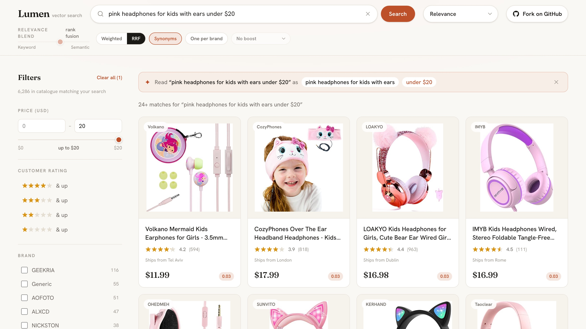

```deck
- agenda: false
```

{.title .no-chrome}


# Vector Search in Production
## Lessons from the front-line
### London Search & AI User Group · November 2026

```authors
- name: Simon Hearne
  position: solutions architect
  company: zilliz
  photo: https://github.com/simonhearne.png
```

---

# The production lifecycle

<svg class="lc-diagram" viewBox="-110 0 1720 625" role="img" aria-label="The production lifecycle of vector search, in five stages that match the sections of this talk: when you need vector search, proof of concept design, validation and tuning, going live, and keeping it running. Below, an illustrative waterfall chart of projects started, with values inferred from a Gartner prediction that at least 30% of generative AI projects are abandoned after proof of concept: 90% get past deciding they need vector search, 45% survive the proof of concept, 35% survive tuning, 30% go live and 25% are still running. The proof of concept is where most projects die, and 70% never reach production.">
<defs>
<marker id="lc-arrow" viewBox="0 0 10 10" refX="9" refY="5" markerWidth="6" markerHeight="6" orient="auto-start-reverse"><path d="M0 0 L10 5 L0 10 z" fill="context-stroke"/></marker>
</defs>
<g>
<path class="lc-edge" d="M264 95 H306"/><path class="lc-edge" d="M574 95 H616"/><path class="lc-edge" d="M884 95 H926"/><path class="lc-edge" d="M1194 95 H1236"/>
</g>
<g><rect class="lc-node" x="10" y="10" width="250" height="170" rx="16"/><text class="lc-num" x="34" y="48">01</text><text class="lc-name" x="135" y="92">When you need</text><text class="lc-name" x="135" y="126">vector search</text><text class="lc-sub" x="135" y="162">names or needs?</text></g>
<g><rect class="lc-node" x="310" y="10" width="260" height="170" rx="16"/><text class="lc-num" x="334" y="48">02</text><text class="lc-name" x="440" y="92">Proof of</text><text class="lc-name" x="440" y="126">concept design</text><text class="lc-sub" x="440" y="162">measure real use</text></g>
<g><rect class="lc-node" x="620" y="10" width="260" height="170" rx="16"/><text class="lc-num" x="644" y="48">03</text><text class="lc-name" x="750" y="92">Validation</text><text class="lc-name" x="750" y="126">&amp; tuning</text><text class="lc-sub" x="750" y="162">what does it cost?</text></g>
<g><rect class="lc-node" x="930" y="10" width="260" height="170" rx="16"/><text class="lc-num" x="954" y="48">04</text><text class="lc-name" x="1060" y="109">Going live</text><text class="lc-sub" x="1060" y="162">survive the writes</text></g>
<g><rect class="lc-node" x="1240" y="10" width="250" height="170" rx="16"/><text class="lc-num" x="1264" y="48">05</text><text class="lc-name" x="1365" y="92">Keeping it</text><text class="lc-name" x="1365" y="126">running</text><text class="lc-sub" x="1365" y="162">watch the drift</text></g>
<g class="fragment" data-fragment-index="1">
<rect class="lc-total" x="-95" y="240" width="90" height="300"/><text class="lc-count" x="-50" y="276">100%</text><text class="lc-tick" x="-50" y="570">started</text>
<path class="lc-link" d="M-5 240 H50"/>
<rect class="lc-drop" x="50" y="240" width="170" height="30"/><text class="lc-loss" x="135" y="300">−10%</text>
<path class="lc-link" d="M220 270 H355"/>
<rect class="lc-drop" x="355" y="270" width="170" height="135"/><text class="lc-loss is-big" x="440" y="445">−45%</text><text class="lc-loss-note" x="440" y="331">never leave</text><text class="lc-loss-note" x="440" y="359">the PoC</text>
<path class="lc-link" d="M525 405 H665"/>
<rect class="lc-drop" x="665" y="405" width="170" height="30"/><text class="lc-loss" x="750" y="465">−10%</text>
<path class="lc-link" d="M835 435 H975"/>
<rect class="lc-drop" x="975" y="435" width="170" height="15"/><text class="lc-loss" x="1060" y="480">−5%</text>
<path class="lc-link" d="M1145 450 H1280"/>
<rect class="lc-drop" x="1280" y="450" width="170" height="15"/><text class="lc-loss" x="1365" y="495">−5%</text>
<path class="lc-link" d="M1450 465 H1505"/>
<rect class="lc-total" x="1505" y="465" width="90" height="75"/><text class="lc-count" x="1550" y="501">25%</text><text class="lc-tick" x="1550" y="570">still running</text>
<path class="lc-axis" d="M-105 540 H1605"/>
<text class="lc-caption" x="-105" y="612">Values inferred, not measured. Anchor: Gartner, July 2024, “30% of generative AI projects will be abandoned after proof of concept by end of 2025”.</text>
</g>
</svg>

<!-- notes
Five stages, one per section tonight. Click: and here's roughly where projects
die. The shape, not the numbers: the stage values are my inference, not
measured. The anchor is Gartner's July 2024 prediction that at least 30% of
generative AI projects would be abandoned after proof of concept by the end of
2025, and the common headline that around 70% of enterprise AI projects never
reach production. Most of the loss is in the PoC, which is why tonight spends
so long there. A talk about production is mostly a talk about getting out of
the PoC with the right evidence.
Source: https://www.gartner.com/en/newsroom/press-releases/2024-07-29-gartner-predicts-30-percent-of-generative-ai-projects-will-be-abandoned-after-proof-of-concept-by-end-of-2025
There is a sixth thing that stops projects, held back for the end.
-->

---

# The checklist I've settled on

Sixteen checks, on any engine:

<div class="card-grid cols-4">
<div class="card">
<p class="case-name">Measure the right thing</p>
<ul class="cl-list">
<li><span class="cl-box" aria-hidden="true"></span>Real search logs</li>
<li><span class="cl-box" aria-hidden="true"></span>Relevance + recall</li>
<li><span class="cl-box" aria-hidden="true"></span>Judged coverage</li>
<li><span class="cl-box" aria-hidden="true"></span>Drift monitoring</li>
</ul>
</div>
<div class="card">
<p class="case-name">Tune the features you ship</p>
<ul class="cl-list">
<li><span class="cl-box" aria-hidden="true"></span>Production filters</li>
<li><span class="cl-box" aria-hidden="true"></span>Partition tax</li>
<li><span class="cl-box" aria-hidden="true"></span>Facet counts</li>
<li><span class="cl-box" aria-hidden="true"></span>Business rules</li>
</ul>
</div>
<div class="card">
<p class="case-name">Know what it costs</p>
<ul class="cl-list">
<li><span class="cl-box" aria-hidden="true"></span>Resident RAM</li>
<li><span class="cl-box" aria-hidden="true"></span>nDCG per GB</li>
<li><span class="cl-box" aria-hidden="true"></span>10× sizing</li>
<li><span class="cl-box" aria-hidden="true"></span>Re-embed price</li>
</ul>
</div>
<div class="card">
<p class="case-name">Survive writes</p>
<ul class="cl-list">
<li><span class="cl-box" aria-hidden="true"></span>Write bursts</li>
<li><span class="cl-box" aria-hidden="true"></span>Update path</li>
<li><span class="cl-box" aria-hidden="true"></span>Model swap</li>
<li><span class="cl-box" aria-hidden="true"></span>Time to searchable</li>
</ul>
</div>
</div>

<!-- notes
Don't read these out. Give them 15 seconds, then ask. Full wording, how to check
each one and the evidence are in the repo README.
-->

---

{.section}

# When you need vector search

<p class="sec-question">Encoding intent</p>

<div class="sec-map">
<ol class="lc-strip" aria-label="Lifecycle stage"><li class="is-now">When</li><li class="">PoC</li><li class="">Tune</li><li class="">Go live</li><li class="">Run</li></ol>
</div>

---

# Brand and intent in one search [[Probe](https://github.com/simonhearne/prod-vector-search#bm25)]{.eyebrow-run}

<div class="search-demo">
  <div class="header fragment">
    <div>
      <div class="query">sephora gift sets for women</div>
    </div>
  </div>

  <div class="body">

  <div class="section fragment">
    <div class="section-title"><span>Keyword</span><span class="tag">BM25</span></div>
    <ol class="results">
      <li class="result"><span class="rank">01</span><span class="title"><span class="hit-text">Sephora</span> Lip Stain 3-Piece Set</span><span class="pill near">Close</span></li>
      <li class="result"><span class="rank">02</span><span class="title"><span class="hit-text">Sephora</span> Eyeshadow Palette</span><span class="pill near">Close</span></li>
      <li class="result"><span class="rank">03</span><span class="title"><span class="hit-text">Sephora</span> Makeup Palette</span><span class="pill near">Close</span></li>
      <li class="result is-hit"><span class="rank">04</span><span class="title"><span class="hit-text">Sephora</span> Brush Set</span><span class="pill hit">Match</span></li>
      <li class="result"><span class="rank">05</span><span class="title"><span class="hit-text">Sephora</span> Brow Pencil</span><span class="pill miss">Wrong</span></li>
    </ol>
    <p class="below-note">All <strong>Sephora</strong>, few <strong>gift sets</strong>.</p>
  </div>

  <div class="section fragment">
    <div class="section-title"><span>Vector</span><span class="tag">dense</span></div>
    <ol class="results">
      <li class="result"><span class="rank">01</span><span class="title">Spa Gift Box · Naha Flume</span><span class="pill near">Close</span></li>
      <li class="result"><span class="rank">02</span><span class="title">Spa Gift Basket · Lovestee</span><span class="pill near">Close</span></li>
      <li class="result"><span class="rank">03</span><span class="title">Bath Gift Basket · Lovery</span><span class="pill near">Close</span></li>
      <li class="result is-hit"><span class="rank">04</span><span class="title"><span class="hit-text">Sephora</span> Igloo Palace Set</span><span class="pill hit">Match</span></li>
      <li class="result"><span class="rank">05</span><span class="title">Spa Gift Basket · Giftsational</span><span class="pill near">Close</span></li>
    </ol>
    <p class="below-note">All <strong>gift sets</strong>, one <strong>Sephora</strong>.</p>
  </div>

  <div class="section fragment is-best">
    <div class="section-title"><span>Hybrid</span><span class="tag">BM25 + dense</span></div>
    <ol class="results">
      <li class="result is-hit"><span class="rank">01</span><span class="title"><span class="hit-text">Sephora</span> Brush Set</span><span class="pill hit">Match</span></li>
      <li class="result is-hit"><span class="rank">02</span><span class="title"><span class="hit-text">Sephora</span> Igloo Palace Set</span><span class="pill hit">Match</span></li>
      <li class="result"><span class="rank">03</span><span class="title">Rihanna Reb'l Fleur Gift Set</span><span class="pill near">Close</span></li>
      <li class="result"><span class="rank">04</span><span class="title">Spa Basket · Best Wishes</span><span class="pill near">Close</span></li>
      <li class="result"><span class="rank">05</span><span class="title"><span class="hit-text">Sephora</span> Mixology Eyeshadow</span><span class="pill near">Close</span></li>
    </ol>
    <p class="below-note">The <strong>brand</strong> and the <strong>intent</strong>, on top.</p>
  </div>

  </div>
</div>

<p class="setup-line"><strong>Setup</strong> A real Amazon shopper's search, top 5 from 448k products.</p>

<!-- notes
Match, Close and Wrong are ESCI's exact, substitute and everything else; the next
section introduces the data. The Igloo set is labelled exact by a human, the brush
set by the LLM judge. Hybrid puts the brush set first because both lists had it.
This search was picked for contrast. Hybrid does not usually win this cleanly: it beats
both arms on 11% of searches (RRF, 100 candidates per arm). Titles are shortened. Source: probes/probe_bm25.json.
-->

---

# You need vectors when shoppers... [[Probe](https://github.com/simonhearne/prod-vector-search#bm25)]{.eyebrow-run}

<br>

<p class="hit-key"><span class="hit-sq is-hit"></span> exact match <span class="hit-sq"></span> anything else, in rank order, top 5</p>

<br>

<div class="card-grid cols-2 hit-cards">
<div class="card fragment">
<p class="feature-cat">…describe a need</p>
<p class="case-name">“nurse accessories for work”</p>
<div class="hit-row"><span class="hit-arm">BM25</span><span class="hit-sqs" role="img" aria-label="1 of 5 exact"><span class="hit-sq is-hit"></span><span class="hit-sq"></span><span class="hit-sq"></span><span class="hit-sq"></span><span class="hit-sq"></span></span><span class="hit-what">tumblers, stickers, a sign</span></div>
<div class="hit-row"><span class="hit-arm">Vector</span><span class="hit-sqs" role="img" aria-label="5 of 5 exact"><span class="hit-sq is-hit"></span><span class="hit-sq is-hit"></span><span class="hit-sq is-hit"></span><span class="hit-sq is-hit"></span><span class="hit-sq is-hit"></span></span><span class="hit-what">nurse bags, belts, penlights</span></div>
</div>
<div class="card fragment">
<p class="feature-cat">…want the product, not its accessories</p>
<p class="case-name">“chromebooks laptops”</p>
<div class="hit-row"><span class="hit-arm">BM25</span><span class="hit-sqs" role="img" aria-label="0 of 5 exact"><span class="hit-sq"></span><span class="hit-sq"></span><span class="hit-sq"></span><span class="hit-sq"></span><span class="hit-sq"></span></span><span class="hit-what">cases and chargers</span></div>
<div class="hit-row"><span class="hit-arm">Vector</span><span class="hit-sqs" role="img" aria-label="5 of 5 exact"><span class="hit-sq is-hit"></span><span class="hit-sq is-hit"></span><span class="hit-sq is-hit"></span><span class="hit-sq is-hit"></span><span class="hit-sq is-hit"></span></span><span class="hit-what">Chromebooks</span></div>
</div>
<div class="card fragment">
<p class="feature-cat">…use another language</p>
<p class="case-name">“radios de comunicacion”</p>
<div class="hit-row"><span class="hit-arm">BM25</span><span class="hit-sqs" role="img" aria-label="0 of 5 exact"><span class="hit-sq"></span><span class="hit-sq"></span><span class="hit-sq"></span><span class="hit-sq"></span><span class="hit-sq"></span></span><span class="hit-what">a bed lift, a book, radio cables</span></div>
<div class="hit-row"><span class="hit-arm">Vector</span><span class="hit-sqs" role="img" aria-label="5 of 5 exact"><span class="hit-sq is-hit"></span><span class="hit-sq is-hit"></span><span class="hit-sq is-hit"></span><span class="hit-sq is-hit"></span><span class="hit-sq is-hit"></span></span><span class="hit-what">walkie talkies</span></div>
</div>
<div class="card fragment is-keep">
<p class="feature-cat">…but keep BM25 for exact attributes</p>
<p class="case-name">“cabinet chrome handles”</p>
<div class="hit-row"><span class="hit-arm">BM25</span><span class="hit-sqs" role="img" aria-label="5 of 5 exact"><span class="hit-sq is-hit"></span><span class="hit-sq is-hit"></span><span class="hit-sq is-hit"></span><span class="hit-sq is-hit"></span><span class="hit-sq is-hit"></span></span><span class="hit-what">polished chrome pulls</span></div>
<div class="hit-row"><span class="hit-arm">Vector</span><span class="hit-sqs" role="img" aria-label="0 of 5 exact"><span class="hit-sq"></span><span class="hit-sq"></span><span class="hit-sq"></span><span class="hit-sq"></span><span class="hit-sq"></span></span><span class="hit-what">nickel, gold and black pulls</span></div>
</div>
</div>

<p class="closing-line is-emphatic fragment fragment-pop">Neither is perfect in all scenarios...</p>

<!-- notes
Vectors add to BM25, they don't replace it. No exact match in the top 5: BM25 13.7%,
text vectors 12.9%, hybrid 10.7%. They miss about as often, on different searches:
hybrid finds an exact match for 54 of the 134 searches BM25 misses, and loses 25.
Hybrid is not on these cards on purpose: they are the lopsided cases. Where one arm
is perfect, fusing in the other can only tie or dilute it: our hybrid got 4, 5, 1 and
4 of 5 here (RRF, equal weights, 100 candidates per arm).
These four are picked for contrast. With exact vector search, BM25 at 0 and vectors
at 3 or more: 24 searches; the reverse: 12. All four hold under exact search (recall
1.0), so they are the model's doing, not the index's. Mostly LLM-judge labels; the
chrome BM25 hits are human. Text vectors only; image is the PoC section's comparison.
Fuzzy matching would fix typos for BM25, so typos are not on this slide.
Source: probes/probe_bm25.json.
-->

---

# Tune hybrid on your own searches [[Probe](https://github.com/simonhearne/prod-vector-search#fusion)]{.eyebrow-run}

<br>

<div class="two-col hybrid-depth">
<div class="card">
<p class="feature-cat">exact matches, top 5</p>
<p class="case-name">“chromebooks laptops”</p>
<div class="hit-row"><span class="hit-arm">BM25</span><span class="hit-sqs" role="img" aria-label="0 of 5 exact"><span class="hit-sq"></span><span class="hit-sq"></span><span class="hit-sq"></span><span class="hit-sq"></span><span class="hit-sq"></span></span><span class="hit-what">cases, chargers</span></div>
<div class="hit-row"><span class="hit-arm">Vector</span><span class="hit-sqs" role="img" aria-label="5 of 5 exact"><span class="hit-sq is-hit"></span><span class="hit-sq is-hit"></span><span class="hit-sq is-hit"></span><span class="hit-sq is-hit"></span><span class="hit-sq is-hit"></span></span><span class="hit-what">Chromebooks</span></div>
<div class="hit-row fragment"><span class="hit-arm">Hybrid, 10 deep</span><span class="hit-sqs" role="img" aria-label="2 of 5 exact"><span class="hit-sq"></span><span class="hit-sq is-hit"></span><span class="hit-sq"></span><span class="hit-sq is-hit"></span><span class="hit-sq"></span></span><span class="hit-what">the lists alternate</span></div>
<div class="hit-row fragment"><span class="hit-arm">Hybrid, 100 deep</span><span class="hit-sqs" role="img" aria-label="5 of 5 exact"><span class="hit-sq is-hit"></span><span class="hit-sq is-hit"></span><span class="hit-sq is-hit"></span><span class="hit-sq is-hit"></span><span class="hit-sq is-hit"></span></span><span class="hit-what">agreement wins</span></div>
</div>
<div class="fragment">

```vega
- spec: ./hybrid-ladder.json
  renderer: svg
  actions: false
  signal-stage: [0, 1, 2, 3]
```

</div>
</div>

<!-- notes
RRF sees ranks, not scores. With 10 candidates per arm it can't see agreement below
the page, so two lists that don't overlap just alternate; 13% of searches share nothing
in the two top 10s. 100 per arm lets documents both arms like rise.
+0.07 ± 0.04 exact matches for depth. Searches with no exact match don't improve (RRF
10: 9.4%, RRF 100: 10.1%, weighted 10.4%, all within noise), so the gain is in ordering.
Depth is no cure: "radios de comunicacion" drops from 2 to 1 exact.
Each arm alone: BM25 2.88, text vectors 3.00 exact of 5. Picking the better arm for
every search would reach 3.44 (the dashed line), so headroom remains. Weighted 70% BM25 against
RRF 100 is within noise (+0.09 ± 0.05 and +0.07 ± 0.04 over RRF 10). "Beat both" is the
share of searches where the fusion has more exact matches than either arm.
Search p50 went from 3.7 to 4.0 ms with 100 per arm, approximate.
Weighted is Milvus's WeightedRanker with normalised scores, 100 per arm, 0.7 BM25 and
0.3 dense; 50% and 30% BM25 scored 3.15 and 3.11. Tuned on these same searches, so treat the winner as
indicative. Until 25 November our own benchmark used 10 per arm.
Source: probes/probe_fusion.json.
-->

---

{.section}

# Proof of concept design

<p class="sec-question">PoCs should match predict production</p>

<div class="sec-map">
<ol class="lc-strip" aria-label="Lifecycle stage"><li class="is-done">When</li><li class="is-now">PoC</li><li class="">Tune</li><li class="">Go live</li><li class="">Run</li></ol>
<p class="sec-checks"><span class="pill navy">Measure · 3 checks</span><span class="pill navy">Features · 1 check</span></p>
</div>

---

# Start from who reads the results

<br>

<div class="card-grid cols-2 readers">
<div class="card is-pick fragment">
<p class="feature-cat">humans</p>
<p class="case-name">A shopper scanning a page</p>
<ul class="case-proof">
<li>Order matters most: the <strong>first page</strong> sets the bar</li>
<li>topK is a page, then deeper pages on demand</li>
<li>Merchandising rules shape what they see</li>
</ul>
</div>
<div class="card fragment">
<p class="feature-cat">LLM / RAG</p>
<p class="case-name">A model reading everything</p>
<ul class="case-proof">
<li>Every result lands in the context: <strong>recall</strong> over order</li>
<li>Small topK, often after a reranker</li>
<li>A wrong result becomes a wrong answer</li>
</ul>
</div>
</div>
<div class="readers-pick fragment" aria-hidden="true"></div>

---

# The test bench [[B1c](https://github.com/simonhearne/prod-vector-search#b1c)]{.eyebrow-run}

<svg class="tb-diagram" viewBox="0 0 1664 630" role="img" aria-label="448k Amazon US products are embedded by two models, Qwen3-Embedding-0.6B for product text and SigLIP ViT-L-16 for product images, into a Milvus 3.0.3 collection with text vectors, image vectors and a BM25 keyword index on the raw text. 1,000 real ESCI shopper searches go through the same two models and search the collection for a top 10. Each top 10 is scored three ways: nDCG@10 against relevance labels, from ESCI's human labels for about 25% of results and Claude Haiku 5.5 for the rest; recall@10 against exact search; and p50 and p99 latency.">
<defs><marker id="tb-ah" viewBox="0 0 10 10" refX="9" refY="5" markerWidth="7" markerHeight="7" orient="auto"><path d="M0 0 L10 5 L0 10 z" fill="context-stroke"/></marker></defs>
<text class="tb-lane" x="0" y="22">INPUTS</text><text class="tb-lane" x="450" y="22">MODELS</text><text class="tb-lane" x="980" y="22">MILVUS 3.0.3 · 4 CPUs · 12 GB</text>
<rect class="tb-box" x="980" y="40" width="682" height="352" rx="14"/>
<path class="tb-wire" d="M340 130 H395 V78 H446" marker-end="url(#tb-ah)"/><path class="tb-wire" d="M395 130 V166 H446" marker-end="url(#tb-ah)"/>
<path class="tb-wire" d="M870 78 H1036" marker-end="url(#tb-ah)"/><path class="tb-wire" d="M870 166 H1036" marker-end="url(#tb-ah)"/>
<path class="tb-wire is-bypass" d="M170 190 V236 H1036" marker-end="url(#tb-ah)"/><text class="tb-note" x="660" y="228">raw text, no model</text>
<rect class="tb-box" x="2" y="70" width="338" height="120" rx="14"/><text class="tb-name" x="171" y="122">448k products</text><text class="tb-sub" x="171" y="156">Amazon US catalogue</text>
<rect class="tb-model" x="450" y="40" width="420" height="76" rx="14"/><text class="tb-name is-model" x="660" y="72">Qwen3-Embedding-0.6B</text><text class="tb-sub is-model" x="660" y="102">product text</text>
<rect class="tb-model" x="450" y="128" width="420" height="76" rx="14"/><text class="tb-name is-model" x="660" y="160">SigLIP ViT-L-16</text><text class="tb-sub is-model" x="660" y="190">product image</text>
<rect class="tb-field" x="1040" y="54" width="580" height="48" rx="24"/><text class="tb-field-name" x="1330" y="86">text vectors · 1,024 d</text>
<rect class="tb-field" x="1040" y="142" width="580" height="48" rx="24"/><text class="tb-field-name" x="1330" y="174">image vectors · 1,024 d</text>
<rect class="tb-field" x="1040" y="212" width="580" height="48" rx="24"/><text class="tb-field-name" x="1330" y="244">BM25 keyword index</text>
<g class="fragment" data-fragment-index="1">
<path class="tb-wire" d="M340 344 H446" marker-end="url(#tb-ah)"/><path class="tb-wire" d="M870 344 H1036" marker-end="url(#tb-ah)"/>
<rect class="tb-box" x="2" y="292" width="338" height="104" rx="14"/><text class="tb-name" x="171" y="336">1,000 searches</text><text class="tb-sub" x="171" y="370">real ESCI shoppers</text>
<rect class="tb-model" x="450" y="306" width="420" height="76" rx="14"/><text class="tb-name is-model" x="660" y="338">same two models</text><text class="tb-sub is-model" x="660" y="368">search side, raw text for BM25</text>
<rect class="tb-field is-search" x="1040" y="320" width="580" height="48" rx="24"/><text class="tb-field-name" x="1330" y="352">search: top 10 results</text>
</g>
<g class="fragment" data-fragment-index="2" transform="translate(0 30)">
<text class="tb-lane" x="0" y="428">SCORED BY</text>
<path class="tb-wire" d="M1330 362 V420 M350 420 H1442"/><path class="tb-wire" d="M350 420 V446" marker-end="url(#tb-ah)"/><path class="tb-wire" d="M960 420 V446" marker-end="url(#tb-ah)"/><path class="tb-wire" d="M1442 420 V446" marker-end="url(#tb-ah)"/>
<rect class="tb-score" x="2" y="450" width="698" height="146" rx="14"/><text class="tb-name" x="351" y="494">nDCG@10 against labels</text><text class="tb-sub" x="351" y="530">ESCI human labels: ~25% of top 10s</text><text class="tb-sub" x="351" y="562">Claude Haiku 5.5 the rest, κ 0.41 against humans</text>
<rect class="tb-score" x="740" y="450" width="440" height="146" rx="14"/><text class="tb-name" x="960" y="494">recall@10</text><text class="tb-sub" x="960" y="530">against exact search</text><text class="tb-sub" x="960" y="562">no labels needed</text>
<rect class="tb-score" x="1220" y="450" width="442" height="146" rx="14"/><text class="tb-name" x="1441" y="494">p50 / p99 latency</text><text class="tb-sub" x="1441" y="530">milliseconds per search</text>
</g>
</svg>

<!-- notes
ESCI is Amazon's shopping queries dataset, joined to Amazon Reviews 2023 for
price, rating, category and images. Text vectors: Qwen3-Embedding-0.6B. Image
vectors: SigLIP ViT-L-16. The judge is Claude Haiku 5.5. Docker is capped at 12 GB and 4 CPUs.
Searches go through the same two models: Qwen3 with the shopping-query instruction, and
SigLIP's text tower. BM25 takes the raw text on both sides. Labels are exact, substitute,
complement or irrelevant.
Human labels cover 23 to 28% of the top 10s, depending on the search (B1a-c, unfiltered).
κ 0.41 is over all four labels, 0.57 on Exact or not. Measured on 1,000 human-labelled
pairs, 250 per label, not the natural mix. A bigger judge isn't much better: Opus against
the humans is 0.52, on 200 of those pairs. Source: results/b1c.json.
Filling doesn't reorder B1c (same order before and after), but don't claim an order between
image and text + BM25: filled nDCG@10 0.658 against 0.653, intervals overlapping, so a tie.
Text alone is 0.634.
-->

---

# Three scores for every search

One search's top 10, scored three ways:

<div class="card-grid metric-defs">
<div class="card">
<p class="feature-cat">Index</p>
<h3 class="case-name">recall@10</h3>
<span class="hit-sqs" role="img" aria-label="9 of 10 results also in exact search's top 10; rank 6 is not"><span class="hit-sq is-hit"></span><span class="hit-sq is-hit"></span><span class="hit-sq is-hit"></span><span class="hit-sq is-hit"></span><span class="hit-sq is-hit"></span><span class="hit-sq"></span><span class="hit-sq is-hit"></span><span class="hit-sq is-hit"></span><span class="hit-sq is-hit"></span><span class="hit-sq is-hit"></span></span>
<p class="md-score">9 of 10 = 0.90</p>
<p class="case-proof">How much of <strong>exact search's</strong> top 10 the index found. It checks the index, not the results.</p>
</div>
<div class="card fragment">
<p class="feature-cat">Relevance</p>
<h3 class="case-name">nDCG@10</h3>
<div class="md-vis">
<span class="hit-sqs" role="img" aria-label="Labels by rank: exact, substitute, exact, irrelevant, exact, irrelevant, complement, irrelevant, substitute, irrelevant"><span class="hit-sq is-hit"></span><span class="hit-sq is-sub"></span><span class="hit-sq is-hit"></span><span class="hit-sq"></span><span class="hit-sq is-hit"></span><span class="hit-sq"></span><span class="hit-sq is-comp"></span><span class="hit-sq"></span><span class="hit-sq is-sub"></span><span class="hit-sq"></span></span>
<span class="md-weights" aria-hidden="true"><span>1.0</span><span>.63</span><span>.50</span><span>.43</span><span>.39</span><span>.36</span><span>.33</span><span>.32</span><span>.30</span><span>.29</span></span>
</div>
<p class="md-score">0.74 of 1.0</p>
<p class="case-proof">Labels score each result: <strong>exact 1</strong>, <strong class="is-sub">substitute 0.1</strong>, <strong class="is-comp">complement 0.01</strong>. An exact match is worth 1 at rank 1, 0.29 at rank 10.</p>
</div>
<div class="card fragment">
<p class="feature-cat">Speed</p>
<h3 class="case-name">p50 / p99</h3>
<div class="md-lat"><div><span class="md-score">1.9 ms</span><span class="stat-note">p50, the middle search</span></div><div><span class="md-score">3.4 ms</span><span class="stat-note">p99, 1 in 100 is slower</span></div></div>
<p class="case-proof">Of 1,000 searches, p99 is the 10th slowest. The tail is what shoppers notice.</p>
</div>
</div>

<p class="setup-line"><strong>Setup</strong> Recall and nDCG: an example top 10. Latency: text vectors, HNSW ef 64, 1,000 searches, one laptop.</p>

<!-- notes
Define the three before the next slide pits recall against nDCG.
Recall@10: the share of exact search's top 10 that the index returned. Exact search
compares the search vector with every vector, so it is the ceiling for the index. No labels needed,
but it only says the index agrees with exact search, not that exact search is any good.
nDCG@10: graded gain per result (exact 1, substitute 0.1, complement 0.01, irrelevant 0),
divided by log2(rank + 1), summed, then divided by the best possible top 10 from all of the
search's labels. Here the search has 4 exact, 3 substitute and 2 complement labels; one exact
product wasn't retrieved, so even a perfect order would score below 1.0.
The example top 10 is made up; the nDCG and recall are computed from it.
Latency is B1b at ef 64 (p50 1.87, p99 3.39 ms), the same run as the next slide.
On the write slides p99 is per 30 s window at 20 searches/s: 600 searches, so the 6th slowest.
That is why those lines are noisy.
± on the slides is 1.96 standard errors of the paired per-search difference
(vsearch/stats.py paired_ci). Single nDCG values use a bootstrap 95% interval.
judged@10 (slides 31, 32): the share of the top 10 that has a label. Unlabelled results
score 0, so low coverage pulls nDCG down; it says whether to trust the nDCG.
-->

---

# Report relevance *and* recall [[B1b](https://github.com/simonhearne/prod-vector-search#b1b)]{.eyebrow-run}

Making HNSW search harder (ef from 10 to 256), on 1,000 judged searches over 448k products:

```vega
- spec: ./b1b-recall-ndcg.json
  renderer: svg
  actions: false
  signal-stage: [0, 1, 2]
  fragment-index: 0
```

<p class="closing-line is-emphatic fragment" data-fragment-index="1">Even at recall 1.0, you only get what the embedding model ranks highest.</p>

<p class="setup-line"><strong>Setup</strong> Text vectors. All ten results labelled: ESCI's human labels, gaps filled by Claude Haiku 5.5.</p>

<!-- notes
Nice to have, not a blocker: exact-search nDCG@10 on the same 1,000 searches (fill new
unjudged results, same judgment pool). Not measured. From the ef trend it should land near
0.64: recall is 0.98 at ef 256 and each doubling past 64 adds about 0.005 nDCG, so it would
sit inside ef 256's interval (0.618 to 0.654). The bracket doesn't depend on it.

x is p50 relative to ef 10 (1.53 ms), so the cost is the distance along the axis.
Points are ef 10, 32, 64, 128, 256. ef 16, 24 and 48 are left off the chart: their p50
(1.47, 1.56, 1.82 ms) is within laptop noise of their neighbours, and ef 16 measured faster
than ef 10, so drawing them makes the line double back. Their recall and nDCG sit on the
curve.
Stage 1, the shaded band: ef 64 to 256 is +0.03 recall and +1.1 pts nDCG for another 2.3x
p50. p99 is worse still (3.4 to 28 ms at 256), but one laptop run, so I don't quote it.
Stage 2, the bracket: recall's ceiling is 1.0 by definition, because exact search is what
recall is measured against. nDCG has no such ceiling from ef. Exact search still ranks by
the same vectors, so it returns what the embedding model thinks is close, relevant or not.

Recall@10: the share of the true nearest neighbours found. nDCG@10: how relevant the top
10 is, scored against the labels. Recall only says HNSW agrees with exact search, not
that exact search is any good.
Don't argue from +15 against +4: different scales, and the curves have nearly the same
shape. By ef 64, recall has made 80% of its gain and nDCG 72%. The point is the level and
the price: +3.0 pts of nDCG for 1.2x p50 to ef 64, then +1.1 for another 2.3x to 256.
ef can't close the rest, the search design can: adding image vectors to these same text
vectors (RRF) gains 6.9 pts (± 1.2), more than the whole sweep's 4.1. Next slide has the
gap over image alone, 4.5.
Each nDCG point is ±0.019, so neighbouring points aren't separable on those intervals.
Before the fill only 23 to 25% of these top 10s had human labels. The sweep gains 4.1 pts
with or without the fill: reassuring, not independent proof, since the share of results
with a human label rises with ef too.
Latency is one laptop run, flat within noise up to ef 32.
Sources: results/b1b.json, probes/probe_text_image.json.
-->


---

# Choose your eval set carefully [[B1a](https://github.com/simonhearne/prod-vector-search#b1a)]{.eyebrow-run}

100 random sets of 50 judged searches, and which search config wins

<br>

<div class="two-col" style="grid-template-columns: 2.1fr 1fr; align-items: center;">
<div>

```vega
- spec: ./b1a-power.json
  renderer: svg
  actions: false
  signal-stage: [0, 1, 2]
  fragment-index: 0
```

</div>
<div>
<div class="stat-card is-warn fragment" data-fragment-index="1"><span class="stat-label">searches written for a PoC</span><span class="stat-value">8 pt swing</span><p class="stat-note">Reword the same 50 searches PoC-style ("lazy susan" → "rotating turntable tray…") and text gains 3 points while image loses 5.</p></div>
</div>
</div>

<p class="closing-line is-emphatic fragment" data-fragment-index="2">50 searches find big gaps. For close calls, use real searches, and lots of them.</p>

<!-- notes
Three close candidates on real Amazon searches: text vectors, image
vectors, and text vectors + BM25 (RRF, 100 candidates per arm). Text + BM25 scores
highest on all 1,000, and 53% of random 50-search sets pick it. But it and image are
tied even on 1,000 (+0.006 ± 0.018), so the other 43% aren't wrong, they just can't
tell. Add text + image (RRF, fused offline): +0.045 ± 0.012 over image, and 88% of
50-search sets pick it. At 200 searches, 99.9%. Big gaps are easy, close ones need far
more searches.
Wording: Claude Opus rewrote the same 50 shopper searches the way an engineer
writes a PoC test set: short descriptive phrases, same intent, so same labels.
lazy susan -> rotating turntable tray for sharing items on a table or in a cabinet.
No person reviewed them. Text +2.8, image -5.2, so the image-text gap moves
8.0 points (± 6.0). Real searches favour image by 2.3 on all 1,000; the
reworded 50 favour text by 8.6. Source: data/curated_queries.jsonl.
If asked why image beats text alone: the benchmark doesn't explain it.
Sources: results/b1a.json, probes/probe_text_image.json.
Callback to Natália: this is why candidate generation's tests lie.
-->

---

{.small-title}

# Run the PoC on the full catalogue [[Probe](https://github.com/simonhearne/prod-vector-search#showcase)]{.eyebrow-run}

<div class="search-demo result-compare">
<div class="header"><div class="query">boombox</div><div class="technique"><strong>Dense vector search, no keywords</strong><span>Qwen3-Embedding-0.6B · HNSW, ef 256 · same on both</span></div><div class="label-key"><span><span class="pill is-human">label</span> by a human</span><span>others: LLM judge</span></div></div>
<div class="body">
<div class="section fragment">
<div class="section-title"><span>PoC · 20k Electronics slice</span><span class="score">nDCG@10 <strong>1.000</strong></span></div>
<ol class="results">
<li class="result is-hit"><span class="rank">01</span><span class="result-thumb"></span><span class="title">Bumpboxx Bluetooth Boombox Flare6 Carbon Fiber | Retro Boombox with Bluetooth Speaker |…</span><span class="pill is-e" title="exact, LLM judge">exact</span></li>
<li class="result is-hit"><span class="rank">02</span><span class="result-thumb"></span><span class="title">RipTunes CD player Boombox- Portable silver Aux-In CD Boombox, AM/FM Radio For Assured…</span><span class="pill is-e is-human" title="exact, ESCI human label">exact</span></li>
<li class="result is-hit"><span class="rank">03</span><span class="result-thumb"></span><span class="title">Riptunes Portable CD Player with AM FM Radio Potable radios Boom Box with Aux Line-in…</span><span class="pill is-e" title="exact, LLM judge">exact</span></li>
<li class="result is-hit"><span class="rank">04</span><span class="result-thumb"></span><span class="title">Riptunes Portable CD Player with AM FM Radio Potable radios Boom Box with Aux Line-in…</span><span class="pill is-e" title="exact, LLM judge">exact</span></li>
<li class="result is-hit"><span class="rank">05</span><span class="result-thumb"></span><span class="title">Wireless Portable Bluetooth Boombox Speaker - 300 Watt Rechargeable Boom Box Speaker…</span><span class="pill is-e" title="exact, LLM judge">exact</span></li>
<li class="result is-hit"><span class="rank">06</span><span class="result-thumb"></span><span class="title">Sony Portable Bluetooth CD Player Boombox Digital Tuner AM/FM Radio Mega Bass Reflex…</span><span class="pill is-e" title="exact, LLM judge">exact</span></li>
<li class="result is-hit"><span class="rank">07</span><span class="result-thumb"></span><span class="title">Magnavox MD6924-PL Portable Top Loading CD Boombox with AM/FM Stereo Radio in Purple |…</span><span class="pill is-e" title="exact, LLM judge">exact</span></li>
<li class="result is-hit"><span class="rank">08</span><span class="result-thumb"></span><span class="title">Wireless Portable Bluetooth Boombox Speaker - 500W Rechargeable Boom Box Speaker…</span><span class="pill is-e" title="exact, LLM judge">exact</span></li>
<li class="result is-hit"><span class="rank">09</span><span class="result-thumb"></span><span class="title">Sony Bluetooth NFC CD Player MP3 Boombox Combo Portable MEGA BASS Stereo| for Home Radio…</span><span class="pill is-e" title="exact, LLM judge">exact</span></li>
<li class="result is-hit"><span class="rank">10</span><span class="result-thumb"></span><span class="title">Victrola 1980s Retro Bluetooth Boombox with Cassette Player and AM/FM Radio, Wired and…</span><span class="pill is-e is-human" title="exact, ESCI human label">exact</span></li>
</ol>
</div>
<div class="section fragment">
<div class="section-title"><span>Production · 448k products</span><span class="score">nDCG@10 <strong>0.720</strong></span></div>
<ol class="results">
<li class="result is-hit"><span class="rank">01</span><span class="result-thumb"></span><span class="title">Bumpboxx Bluetooth Boombox Flare6 Carbon Fiber | Retro Boombox with Bluetooth Speaker |…</span><span class="pill is-e" title="exact, LLM judge">exact</span></li>
<li class="result is-hit"><span class="rank">02</span><span class="result-thumb"></span><span class="title">RipTunes CD player Boombox- Portable silver Aux-In CD Boombox, AM/FM Radio For Assured…</span><span class="pill is-e is-human" title="exact, ESCI human label">exact</span></li>
<li class="result is-hit"><span class="rank">03</span><span class="result-thumb"></span><span class="title">Riptunes Portable CD Player with AM FM Radio Potable radios Boom Box with Aux Line-in…</span><span class="pill is-e" title="exact, LLM judge">exact</span></li>
<li class="result is-hit"><span class="rank">04</span><span class="result-thumb"></span><span class="title">Riptunes Portable CD Player with AM FM Radio Potable radios Boom Box with Aux Line-in…</span><span class="pill is-e" title="exact, LLM judge">exact</span></li>
<li class="result"><span class="rank">05</span><span class="result-thumb"></span><span class="title">Bible Boomers Volume 1 w/ CD</span><span class="pill is-i" title="irrelevant, LLM judge">irrelevant</span></li>
<li class="result"><span class="rank">06</span><span class="result-thumb"></span><span class="title">BOOMWHACKERS Boomwhackers Tubes Treble Extension Set,Set of 7</span><span class="pill is-i" title="irrelevant, LLM judge">irrelevant</span></li>
<li class="result is-hit"><span class="rank">07</span><span class="result-thumb"></span><span class="title">Kids CD Boombox Portable Audio CD Player, LONPOO FM Stereo Radio CD MP3 Player with…</span><span class="pill is-e" title="exact, LLM judge">exact</span></li>
<li class="result is-hit"><span class="rank">08</span><span class="result-thumb"></span><span class="title">Wireless Portable Bluetooth Boombox Speaker - 300 Watt Rechargeable Boom Box Speaker…</span><span class="pill is-e" title="exact, LLM judge">exact</span></li>
<li class="result"><span class="rank">09</span><span class="result-thumb"></span><span class="title">T.J. Wiseman Remote Controlled Fart Machine No. 2 - Pack of 2</span><span class="pill is-s" title="substitute, LLM judge">substitute</span></li>
<li class="result"><span class="rank">10</span><span class="result-thumb"></span><span class="title">Gejoy 2 Pieces Inflatable Radio Boombox Inflatable Mobile Phone Props for 80s 90s Party…</span><span class="pill is-s" title="substitute, LLM judge">substitute</span></li>
</ol>
</div>
</div>
</div>
<p class="closing-line is-emphatic fragment">Slicing misleads both ways: of 63 fully labelled searches, production scored lower on 14 and higher on 40.</p>

<!-- notes
Dense text vectors only: no BM25, no rerank. Both sides use the same embeddings and HNSW
settings (M 16, efConstruction 200, ef 256, cosine); only the catalogue changes.
In the Electronics slice nothing can go wrong. With every category in, dense search drifts
to things that only resemble the word: Bible Boomers, Boomwhackers.
All 20 results are labelled, 3 by ESCI humans (person icon) and 17 by the LLM judge. Calling
the fart machine and the inflatable props substitutes is generous.
Picked by hand from 4,984 Electronics searches. It's the rarer direction: of the 63 with every
result labelled, production scores higher on 40 and lower on 14, because the slice
is missing good matches. Source: probes/probe_boombox.json.
0.06 and 0.64 are means over the 50 PoC searches at ef 192 (results/showcase.json): 45 of
the 50 belong to categories the slice doesn't have.
-->

---

# Test every index on narrow filters [[B2](https://github.com/simonhearne/prod-vector-search#b2)]{.eyebrow-run}

<div class="search-demo result-filter">
<div class="header"><div class="query">watch dogs 2</div><div class="filter-chips"><span class="filter-chip"><span class="field">Category</span>Video Games</span><span class="filter-chip"><span class="field">Price</span>$5–20</span><span class="filter-chip"><span class="field">Rating</span><span class="stars" aria-hidden="true">★★★★<span class="is-off">★</span></span> 4+</span><span class="filter-chip"><span class="field">Brand</span>Ubisoft</span></div><div class="match-count fragment fragment-pop"><strong>23</strong> of 447,880<br>products match</div></div>
<div class="result-strips">
<div class="result-strip fragment">
<div class="stat-card"><span class="stat-label">HNSW</span><div class="strip-stats"><div><span class="stat-value">10 of 10</span><span class="stat-note">recall@10 1.0</span></div></div></div>
<ol class="result-slots">
<li class="result-slot"><span class="result-thumb"></span></li>
<li class="result-slot"><span class="result-thumb"></span></li>
<li class="result-slot"><span class="result-thumb"></span></li>
<li class="result-slot"><span class="result-thumb"></span></li>
<li class="result-slot"><span class="result-thumb"></span></li>
<li class="result-slot"><span class="result-thumb"></span></li>
<li class="result-slot"><span class="result-thumb"></span></li>
<li class="result-slot"><span class="result-thumb"></span></li>
<li class="result-slot"><span class="result-thumb"></span></li>
<li class="result-slot"><span class="result-thumb"></span></li>
</ol>
</div>
<div class="result-strip fragment">
<div class="stat-card is-warn"><span class="stat-label">IVF_RABITQ · nprobe 8</span><div class="strip-stats"><div><span class="stat-value">0 of 10</span><span class="stat-note">recall@10 0.0</span></div></div></div>
<ol class="result-slots">
<li class="result-slot is-empty" aria-label="no result"><span class="result-thumb"></span></li>
<li class="result-slot is-empty" aria-label="no result"><span class="result-thumb"></span></li>
<li class="result-slot is-empty" aria-label="no result"><span class="result-thumb"></span></li>
<li class="result-slot is-empty" aria-label="no result"><span class="result-thumb"></span></li>
<li class="result-slot is-empty" aria-label="no result"><span class="result-thumb"></span></li>
<li class="result-slot is-empty" aria-label="no result"><span class="result-thumb"></span></li>
<li class="result-slot is-empty" aria-label="no result"><span class="result-thumb"></span></li>
<li class="result-slot is-empty" aria-label="no result"><span class="result-thumb"></span></li>
<li class="result-slot is-empty" aria-label="no result"><span class="result-thumb"></span></li>
<li class="result-slot is-empty" aria-label="no result"><span class="result-thumb"></span></li>
</ol>
</div>
</div>
</div>

---

# Replay your production filters [[B2](https://github.com/simonhearne/prod-vector-search#b2)]{.eyebrow-run}

200 searches, each with a filter that matches under 0.1% of 448k products, but at least 10 of them:

<div class="two-col" style="grid-template-columns: 2.1fr 1fr; align-items: center;">
<div>

```vega
- spec: ./ivf-filter.json
  renderer: svg
  actions: false
  signal-stage: [0, 1, 2]
  fragment-index: 0
```

</div>
<div class="fragment" data-fragment-index="1">

Searches returning **all 10**:

<div class="stat-card is-warn"><span class="stat-label">IVF_RABITQ · nprobe 8</span><span class="stat-value">63.5%</span></div>
<br>
<div class="stat-card is-warn"><span class="stat-label">IVF_RABITQ · nprobe 64</span><span class="stat-value">84.5%</span></div>
<br>
<div class="stat-card"><span class="stat-label">HNSW</span><span class="stat-value">100%</span></div>
</div>
</div>

<p class="closing-line is-emphatic fragment" data-fragment-index="2">Bucket them by selectivity, score recall against <em>exact filtered</em> search, and count short pages.</p>

<!-- notes
The picture is an illustration: 500 vectors, 24 cells. Ours had nlist 1024, so
nprobe 8 is under 1% of cells. IVF only looks inside the cells it visits, so a
narrow filter runs out of candidates there. That mechanism is how IVF works; we
measured the short pages, not the cause. Raising nprobe helps but is not a cure.
The rates are 200 searches per bucket, with at least 10 matches each. Full pages: 127 of
200 at nprobe 8, 169 at nprobe 64, all 200 on HNSW.
-->

---

{.section}

# Validation & Tuning

<p class="sec-question">What does each point of relevance cost?</p>

<div class="sec-map">
<ol class="lc-strip" aria-label="Lifecycle stage"><li class="is-done">When</li><li class="is-done">PoC</li><li class="is-now">Tune</li><li class="">Go live</li><li class="">Run</li></ol>
<p class="sec-checks"><span class="pill navy">Cost · 4 checks</span><span class="pill navy">Features · 2 checks</span></p>
</div>

---

{.stat-context}

# Find the slow stage before you tune

One search, adapted from a customer's trace: **466 ms**

<div class="trace">
<div class="tr-row"><span class="tr-label">SQL filter</span><span class="tr-track"><i style="--s:0;--d:26"></i></span><span class="tr-ms">26 ms</span></div>
<div class="tr-row is-parent"><span class="tr-label">Vector database</span><span class="tr-track"><i style="--s:26;--d:405"></i></span><span class="tr-ms">405 ms</span></div>
<div class="tr-row is-child is-network fragment" data-fragment-index="2"><span class="tr-label">network to model</span><span class="tr-track"><i style="--s:26;--d:17"></i></span><span class="tr-ms">~17 ms</span></div>
<div class="tr-row is-child is-embed fragment" data-fragment-index="1"><span class="tr-label">embed the search text</span><span class="tr-track"><i style="--s:43;--d:358"></i></span><span class="tr-ms">~358 ms</span></div>
<div class="tr-row is-child is-network fragment" data-fragment-index="2"><span class="tr-label">network to database</span><span class="tr-track"><i style="--s:401;--d:11"></i></span><span class="tr-ms">~11 ms</span></div>
<div class="tr-row is-child is-search fragment" data-fragment-index="1"><span class="tr-label">vector search</span><span class="tr-track"><i style="--s:412;--d:19"></i></span><span class="tr-ms">~19 ms</span></div>
<div class="tr-row"><span class="tr-label">Hydrate rows</span><span class="tr-track"><i style="--s:431;--d:14"></i></span><span class="tr-ms">14 ms</span></div>
<div class="tr-row"><span class="tr-label">Matched chunk</span><span class="tr-track"><i style="--s:445;--d:21"></i></span><span class="tr-ms">21 ms</span></div>
</div>

<p class="setup-line"><strong>Setup</strong> One request, timings adjusted. <span class="fragment" data-fragment-index="1">The split inside the span is estimated. On our own bench, embedding is 33 of 41 ms.</span></p>

<p class="closing-line is-emphatic fragment" data-fragment-index="3">Over 90% of the "database" span was the embedding service.</p>

<!-- notes
Adapted from a customer's trace. The timings are adjusted, so quote the shape, not the milliseconds.
Start on the flat version and ask: what would you fix? Everyone says the database: 405 of 466 ms.
Then open the span. It wrapped the call to a hosted embedding API and the search in one timer. The
search is about 19 ms, 4% of the request. Tuning the index would save nothing a shopper could
feel; caching search embeddings or a closer model would.
Second reveal: the gaps are the network. 17 ms to the embedding service, 11 ms to the database.
The flow: SQL filter for candidate IDs, embed the search text, vector search, fetch the rows in result
order, pick the matched chunk. The order of the bars is the flow, not recorded start times, and
each round trip is drawn as one block before the work it belongs to.
Arithmetic: 17 + 358 + 11 + 19 = 405; 26 + 405 + 14 + 21 = 466. Embedding call with its
network is 375 of 405, 93%; without it 88%, so say "the embedding call", not "embedding".
The split inside the span is estimated. One request, believed to be a single search round. Not a
percentile.
Our bench: 50 searches, Qwen3-Embedding-0.6B one search at a time on an M5 laptop, Milvus on the same
machine, top 10 of 448k, HNSW ef 192. Embed p50 33.0 ms, search p50 8.1 ms, total p50 41.0 ms,
embedding share 81% at p50. Compare the ratio, not the milliseconds.
Source for the bench: results/showcase.json latency_split.
-->

---

{.stat-context}

# Be mindful of merchandisers! [[B5](https://github.com/simonhearne/prod-vector-search#b5)]{.eyebrow-run}

<div class="search-demo result-filter result-boost">
<div class="header"><div class="query">xbox one x</div><div class="filter-chips"><span class="filter-chip"><span class="field">Campaign</span>Black Friday sale</span><span class="filter-chip"><span class="field">On sale</span>22k products, 6,323 random brands</span><span class="filter-chip"><span class="field">The boost</span>sale products: score × weight</span></div></div>
<div class="result-strips">
<div class="result-strip fragment">
<div class="stat-card"><strong class="boost-name">No boost</strong><div class="strip-stats"><div><span class="stat-value">0.64</span><span class="stat-note">nDCG@10</span></div><div><span class="stat-value">5.5%</span><span class="stat-note">slots on sale</span></div></div></div>
<ol class="result-slots">
<li class="result-slot"><span class="result-thumb"></span></li>
<li class="result-slot"><span class="result-thumb"></span></li>
<li class="result-slot"><span class="result-thumb"></span></li>
<li class="result-slot"><span class="result-thumb"></span></li>
<li class="result-slot"><span class="result-thumb"></span></li>
<li class="result-slot"><span class="result-thumb"></span></li>
<li class="result-slot"><span class="result-thumb"></span></li>
<li class="result-slot"><span class="result-thumb"></span></li>
<li class="result-slot"><span class="result-thumb"></span></li>
<li class="result-slot"><span class="result-thumb"></span></li>
</ol>
</div>
<div class="result-strip fragment">
<div class="stat-card"><strong class="boost-name">Boost ×1.1</strong><div class="strip-stats"><div><span class="stat-value">0.61</span><span class="stat-note">nDCG@10</span></div><div><span class="stat-value">25%</span><span class="stat-note">slots on sale</span></div></div></div>
<ol class="result-slots">
<li class="result-slot"><span class="result-thumb"></span></li>
<li class="result-slot"><span class="result-thumb"></span></li>
<li class="result-slot"><span class="result-thumb"></span></li>
<li class="result-slot"><span class="result-thumb"></span></li>
<li class="result-slot"><span class="result-thumb"></span></li>
<li class="result-slot"><span class="result-thumb"></span></li>
<li class="result-slot"><span class="result-thumb"></span></li>
<li class="result-slot is-sale"><span class="result-thumb"></span><span class="sale-tag">sale</span></li>
<li class="result-slot"><span class="result-thumb"></span></li>
<li class="result-slot"><span class="result-thumb"></span></li>
</ol>
</div>
<div class="result-strip fragment">
<div class="stat-card is-warn"><strong class="boost-name">Boost ×1.5</strong><div class="strip-stats"><div><span class="stat-value">0.26</span><span class="stat-note">nDCG@10</span></div><div><span class="stat-value">93%</span><span class="stat-note">slots on sale</span></div></div></div>
<ol class="result-slots">
<li class="result-slot is-sale"><span class="result-thumb"></span><span class="sale-tag">sale</span></li>
<li class="result-slot is-sale"><span class="result-thumb"></span><span class="sale-tag">sale</span></li>
<li class="result-slot is-sale"><span class="result-thumb"></span><span class="sale-tag">sale</span></li>
<li class="result-slot is-sale"><span class="result-thumb"></span><span class="sale-tag">sale</span></li>
<li class="result-slot is-sale"><span class="result-thumb"></span><span class="sale-tag">sale</span></li>
<li class="result-slot is-sale"><span class="result-thumb"></span><span class="sale-tag">sale</span></li>
<li class="result-slot is-sale"><span class="result-thumb"></span><span class="sale-tag">sale</span></li>
<li class="result-slot is-sale"><span class="result-thumb"></span><span class="sale-tag">sale</span></li>
<li class="result-slot is-sale"><span class="result-thumb"></span><span class="sale-tag">sale</span></li>
<li class="result-slot is-sale"><span class="result-thumb"></span><span class="sale-tag">sale</span></li>
</ol>
</div>
</div>
</div>
<p class="closing-line is-emphatic fragment">nDCG can't price a sale. Show the business the curve and let them pick the weight.</p>
<p class="setup-line"><strong>Setup</strong> Card numbers are over 1,000 judged searches. Text vectors, HNSW ef 512, 448k products, Milvus boost ranker over 200 results.</p>

<!-- notes
A boost is a ranking rule: products on the sale get their score multiplied. Here 22k products
from 6,323 whole brands (Amazon Basics, Coleman, GoPro) are on a made-up Black Friday sale. The
catalogue has no real campaigns, so the brands are random. Only the scores change, not the index.
The shopper wants an Xbox One X. No boost: ten consoles. ×1.1: nine, plus one controller skin.
×1.5: every slot is on sale and not one is a console: skins, thumb grips, chargers, a headset.
The white box that looks like one is a battery charger for controllers.
The weight multiplies a sale product's search score. Text scores sit close together (the 100th
result typically scores 77% of the first), so ×1.5 lifts nearly any sale product in the top 100
above everything else; ×1.1 only moves the ones that were already close.
Card numbers are over all 1,000 searches: nDCG 0.637, 0.614, 0.263. This page: 1.00, 0.93, 0.01.
nDCG can't say what a sale is worth. The business picks the trade, but it has to see the curve.
Average cost: 2.3 points at ×1.1 (± 0.5), 37.4 at ×1.5 (± 1.8). The card's second number is
slot share: of all 10,000 top-10 slots, the share held by sale products. Reach, the share of
pages with at least one sale product, saturates first: 33%, 78%, 99.9%.
Picked by hand, and at the extreme end: at ×1.5, 37% of searches fall below nDCG 0.1, but only
13% of the 256 that start above 0.9.
Fix the candidate depth as well, or reach moves with the segment layout. Milvus rescores only the
candidates each segment returns: ask for 10 results at ×1.5 and the sale reaches 65% of pages
with the data in 3 segments, 95% partitioned by category into 14. Asking for 200, they agree.
The layouts differ in both segment count and partitioning, so neither is isolated.
Reach counts the 999 searches with a sale product in their top 500. ×1.2 is in between:
94% of pages, 52% of slots, nDCG 0.527.
Sources: results/b5.json, probes/probe_campaign.json.
-->

---

{.stat-context}

# Build search facets from the top results [[B2c](https://github.com/simonhearne/prod-vector-search#b2c)]{.eyebrow-run}

<div class="search-demo result-filter result-facets">
<div class="header"><div class="query">xbox one x</div><div class="match-count fragment fragment-pop"><strong>All 447,880</strong><br>products match</div></div>
<div class="body">
<div class="section is-exact fragment">
<div class="section-title"><span>Count every match</span><span class="tag">ignores the search</span></div>
<div class="facet-groups">
<div><p class="facet-head">Category</p><ul class="facet-list">
<li style="--v:1.000"><span class="facet-name">Home and Kitchen</span><span class="facet-bar"></span><span class="facet-n">56,155</span></li>
<li style="--v:0.674"><span class="facet-name">Books</span><span class="facet-bar"></span><span class="facet-n">37,872</span></li>
<li style="--v:0.633"><span class="facet-name">Clothing, Shoes, Jewelry</span><span class="facet-bar"></span><span class="facet-n">35,527</span></li>
</ul></div>
<div><p class="facet-head">Brand</p><ul class="facet-list">
<li style="--v:1.000"><span class="facet-name">LEGO</span><span class="facet-bar"></span><span class="facet-n">1,300</span></li>
<li style="--v:0.845"><span class="facet-name">Nike</span><span class="facet-bar"></span><span class="facet-n">1,098</span></li>
<li style="--v:0.631"><span class="facet-name">HP</span><span class="facet-bar"></span><span class="facet-n">820</span></li>
</ul></div>
</div>
<div class="facet-cost"><div><span class="stat-value">9.0 ms</span><span class="stat-note">p50</span></div><div><span class="stat-value">59.2 ms</span><span class="stat-note">p99, 4.4× search alone</span></div></div>
</div>
<div class="section is-top fragment">
<div class="section-title"><span>Count the top 100</span><span class="tag">a sample, not totals</span></div>
<div class="facet-groups">
<div><p class="facet-head">Category</p><ul class="facet-list">
<li style="--v:1.000"><span class="facet-name">Video Games</span><span class="facet-bar"></span><span class="facet-n">83</span></li>
<li style="--v:0.205"><span class="facet-name">Electronics</span><span class="facet-bar"></span><span class="facet-n">17</span></li>
</ul></div>
<div><p class="facet-head">Brand</p><ul class="facet-list">
<li style="--v:1.000"><span class="facet-name">Microsoft</span><span class="facet-bar"></span><span class="facet-n">48</span></li>
<li style="--v:0.312"><span class="facet-name">Avolusion</span><span class="facet-bar"></span><span class="facet-n">15</span></li>
<li style="--v:0.062"><span class="facet-name">YCCSKY</span><span class="facet-bar"></span><span class="facet-n">3</span></li>
</ul></div>
</div>
<div class="facet-cost"><div><span class="stat-value">3.1 ms</span><span class="stat-note">p50</span></div><div><span class="stat-value">21.5 ms</span><span class="stat-note">p99, 1.6× search alone</span></div></div>
</div>
</div>
</div>

<p class="closing-line is-emphatic fragment">Searching: count the top 100, and hide the numbers. Browsing: count exactly, or precompute.</p>

<p class="setup-line"><strong>Setup</strong> Search plus facets over 1,000 searches, unfiltered to &lt;0.1%, HNSW ef 192. Search alone: p50 3.1 ms, p99 13.5 ms.</p>

<!-- notes
Vector search has no natural set of matches: every product gets a score. So "count every match"
counts whatever passes the filter, and with no filter that is the whole catalogue, the same list
for every shopper. A shopper after an Xbox One X is offered Home and Kitchen, Books and LEGO.
In the whole catalogue Video Games is 21st of 34 categories (4,447 products) and Microsoft is
29th by brand (376), counting blank and Unknown as brands.
The top 100 fit the search, but they are counts of 100 results: 48 is not how many Microsoft
products there are (376), and it would change with the depth. The numbers are here to make the
point; leave them off the page. Brands get thin fast: after YCCSKY's 3 it is twos and ones.
On a browse page there is no search text, so the filter is the question and an exact count is right.
Judgement, not measured: that top-100 facets are more useful, the browse advice, and the depth of
100. Measured: the cost of each, and the difference below.
Not only this search: for none of 1,000 unfiltered searches is the catalogue's top 5 categories, or
top 5 brands, the top 5 of its 100 results, under any tie-break. Same text vectors, top 100.
Filters narrow the exact count to the filtered set, but still ignore the search. Precomputing
the counts per category or filter is not measured.
Times: p50 / p95 / p99 in ms. Search alone 3.1 / 8.3 / 13.5. Exact 9.0 / 44.3 / 59.2 (the search,
then two group-by queries, one after the other). Top 100 3.1 / 7.7 / 21.5.
Replaced here: "80% category, 18% brand agree". Those were the searches where the two have to
agree: 80.0% filter on one category, and 17.8% filter on one brand or match 100 products or fewer.
Sources: results/b2c.json (times), data/work/deep_rankings.json and products.parquet (counts).
-->

---

# Choose on nDCG per GB, not recall [[B3a](https://github.com/simonhearne/prod-vector-search#b3a)]{.eyebrow-run}

<br>

```vega
- spec: ./b3a-frontier.json
  renderer: svg
  actions: false
  signal-stage: [0, 1, 2, 3, 4]
  fragment-index: 0
```

<!-- notes
Blue is HNSW, amber diamonds are IVF_RABITQ. FP16: yes, by default.
The SQ8 points are HNSW_SQ with an FP16 refine copy in RAM, which is why they take more
RAM than FP16 alone. Pure SQ8 was not measured here (next slide, TODO).
RaBitQ and truncation: at scale, when the RAM bill justifies the cost.
RaBitQ is slower to search, untuned: p50 63 ms at nprobe 64 against 1.7 ms for FP32 HNSW
at ef 64 (see the TODO on the next slide). Do not quote the ratio. At about 0.65 GB you can have RaBitQ 1024 (0.623), FP16 512 (0.596) or
FP32 256 (0.571). The 0.6 pt FP16 drop is well inside the interval; the interval
is per point. BF16 was not measured.
-->

---

{.stat-context}

# Cost it for production [[B3b](https://github.com/simonhearne/prod-vector-search#b3b)]{.eyebrow-run}

```vega
- spec: ./b3b-sizing.json
  renderer: svg
  actions: false
  signal-stage: [0, 1, 2, 3]
  fragment-index: 0
```

<p class="setup-line"><strong>Setup</strong> Estimated resident RAM, 1,024 dims, scaled from 448k, row data counted once. AWS r8g on-demand, London: $6.31 per GiB a month, no headroom.</p>

<blockquote class="blue fragment" data-fragment-index="1"><span class="label">And the re-embed time</span><p>Every model change re-embeds 10M products: 135 h for text and 167 h for images on one laptop GPU.</p><p class="stamp-sub">Apple M5: 20.6 text / 16.6 images per second</p></blockquote>

<!-- notes
TODO (after the live benchmark, estimates until then): build HNSW SQ8 without refine and
IVF_RABITQ without refine on the 448k, measure RAM, nDCG@10 and p50; split per-row from
per-vector bytes with the data_type label of internal_cache_loaded_bytes; then correct
this chart and b3b_cost_table.py, which still multiplies row data by 2 vectors.
TODO (re-embed $): measure Qwen3-0.6B and SigLIP throughput on one cloud GPU (AWS eu-west-2,
to match the RAM prices), rerun b3c with --gpu-usd-per-hour, then put $ and hours back in the
blockquote and relabel it "And the re-embed bill". b3c.json has usd_per_hour 0 today.
TODO (same run, search-time settings only, no rebuild): on f_1024_rabitq sweep
rbq_query_bits 0/8/6, refine_k 1 to 5 and nprobe, and compare p50 with HNSW at matched
nDCG. Recheck "same nDCG" on slides 21 and 22 at the settings it picks. Arm laptop only, no x86 run, so quote any ratio as "on this laptop".

Blue is HNSW, amber is IVF_RABITQ. Bars above the line are HNSW FP32, the PoC default.
Below the line everything is at 10M products, text and image vectors, 2 replicas.
Measured bytes per vector, 448k: FP32 4,501, FP16 2,453, RaBitQ with SQ8 refine 1,466.
Estimated: HNSW SQ8 1,429 (1,024 plus the HNSW overhead), RaBitQ without refine 442
(1,466 minus 1,024). About 254 B of each is row data (keys, scalar fields), inferred by
subtraction and counted once per row, so each bar is ~5 GB below plain multiplication.
RaBitQ bars: amber is the 1-bit codes, 128 B a vector, 1/32 of 4,096 (5 of 164 GB). Grey
is everything else resident. Light amber is SQ8 refine, 1,024 B a vector, 41 GB.
HNSW SQ8 is the one to beat: 52 GB against 54 for RaBitQ + SQ8, if its nDCG holds. In
rag-cost-curve at 10M, IVF_SQ8 took 10.8 GiB against 12.2 for RaBitQ + SQ8 refine, at
the same recall@10 (0.992) and 10x the throughput. RaBitQ without refine there was 14.1x smaller
than raw, not 32x, with recall@10 of 0.78.
Refine is only fast with the SQ8 data resident, and it was resident here. RaBitQ latency is
untuned: 63 ms p50 (nprobe 64) against 1.7 for FP32 HNSW (ef 64), with rbq_query_bits 0
(the default, documented as slowest), refine_k 1 (rescores only as many candidates as it
returns) and no AVX-512 on Apple silicon. If asked: slower, by how much is not settled.
nDCG@10: FP32 0.623, FP16 0.617, RaBitQ + SQ8 0.623.
Overhead barely shrinks with scale: centroids are per segment, about 19 of 314 B here,
and rag-cost-curve went from 305 to 290 B a vector between 1M and 10M.
Dollars are AWS eu-west-2 Linux on-demand, price list of 24 Nov 2026, 730 h a month:
whole instance price divided by its RAM, so each 8 GiB brings 1 vCPU. No headroom, and
not rounded up to whole instances. On c8g it is $17.24 per GiB a month, 2.7x r8g, since
c8g has 4x the cores per GiB: FP32 $2,808, FP16 $1,493, HNSW SQ8 $836, RaBitQ + SQ8 $860.
RaBitQ may need more CPU than its RAM brings, so treat its price as a lower bound.
-->

---

{.section}

# Going Live

<p class="sec-question">What happens to reads while you write?</p>

<div class="sec-map">
<ol class="lc-strip" aria-label="Lifecycle stage"><li class="is-done">When</li><li class="is-done">PoC</li><li class="is-done">Tune</li><li class="is-now">Go live</li><li class="">Run</li></ol>
<p class="sec-checks"><span class="pill navy">Writes · 4 checks</span><span class="pill navy">Features · 1 check</span></p>
</div>

---

{.no-chrome}

# Where a write goes before it's searchable

<svg class="ws-diagram" viewBox="15 0 1070 580" role="img" aria-label="Milvus architecture in three steps. A proxy sits in front of three columns: ingest on the streaming node, index on the data node, search on the query node, with object storage shared beneath them. Inserted documents land in a growing segment on the streaming node, which seals and flushes to object storage; a data node builds the index and writes it back, and a query node loads the indexed segment. The collection has two partitions: two growing segments on the streaming node and four indexed segments on the query node. A search for partition B goes from the proxy to both nodes and skips everything in partition A: the streaming node scans every vector in one unindexed growing segment, the query node follows a few hops through two indexed segments, and the proxy merges the results.">
<defs>
<marker id="ws-ah" viewBox="0 0 10 10" refX="9" refY="5" markerWidth="7" markerHeight="7" orient="auto-start-reverse"><path d="M0 0 L10 5 L0 10 z" fill="context-stroke"/></marker>
<symbol id="ws-seg-sealed" viewBox="0 0 60 60"><rect class="ws-seg is-sealed" x="2" y="2" width="56" height="56" rx="8"/><g class="ws-dots"><circle cx="14" cy="16" r="3.5"/><circle cx="30" cy="12" r="3.5"/><circle cx="44" cy="20" r="3.5"/><circle cx="18" cy="34" r="3.5"/><circle cx="36" cy="30" r="3.5"/><circle cx="48" cy="44" r="3.5"/><circle cx="24" cy="48" r="3.5"/></g></symbol>
<symbol id="ws-seg-indexed" viewBox="0 0 60 60"><rect class="ws-seg is-indexed" x="2" y="2" width="56" height="56" rx="8"/><path class="ws-edges" d="M14 16 L30 12 L44 20 L36 30 L18 34 Z M36 30 L48 44 L24 48 L18 34 M30 12 L36 30"/><g class="ws-dots is-indexed"><circle cx="14" cy="16" r="3.5"/><circle cx="30" cy="12" r="3.5"/><circle cx="44" cy="20" r="3.5"/><circle cx="18" cy="34" r="3.5"/><circle cx="36" cy="30" r="3.5"/><circle cx="48" cy="44" r="3.5"/><circle cx="24" cy="48" r="3.5"/></g></symbol>
<symbol id="ws-seg-growing" viewBox="0 0 60 60"><rect class="ws-seg is-growing" x="2" y="2" width="56" height="56" rx="8"/><g class="ws-dots"><circle cx="14" cy="16" r="3.5"/><circle cx="30" cy="12" r="3.5"/><circle cx="44" cy="20" r="3.5"/><circle cx="18" cy="34" r="3.5"/><circle cx="36" cy="30" r="3.5"/></g></symbol>
</defs>
<g class="ws-arch">
<g class="ws-links"><path d="M232 250 L288 198"/><path d="M175 208 C175 -40 820 -40 820 150 V290 Q820 314 848 314"/><path d="M400 382 V438"/><path d="M680 382 V438"/><path d="M960 382 V438"/></g>
<text class="ws-lane" x="400" y="72">INGEST</text><text class="ws-lane" x="680" y="72">INDEX</text><text class="ws-lane" x="960" y="72">SEARCH</text>
<rect class="ws-proxy" x="120" y="210" width="110" height="110" rx="12"/><text class="ws-name" x="175" y="271">Proxy</text>
<rect class="ws-node" x="290" y="90" width="220" height="290" rx="14"/><text class="ws-name" x="400" y="124">Streaming node</text>
<rect class="ws-node" x="570" y="90" width="220" height="290" rx="14"/><text class="ws-name" x="680" y="124">Data node</text>
<rect class="ws-node" x="850" y="90" width="220" height="290" rx="14"/><text class="ws-name" x="960" y="124">Query node</text>
<rect class="ws-node" x="290" y="440" width="780" height="110" rx="14"/>
<text class="ws-name" x="1050" y="540" text-anchor="end">Object storage</text>
</g>
<g class="ws-insert">
<g class="ws-docs ws-step ws-a-slide fragment" data-fragment-index="1"><rect class="ws-doc" x="28" y="230" width="22" height="28" rx="3"/><rect class="ws-doc" x="44" y="248" width="22" height="28" rx="3"/><rect class="ws-doc" x="60" y="266" width="22" height="28" rx="3"/></g>
<path class="ws-arrow ws-step ws-a-draw fragment" data-fragment-index="1" style="--d:200ms" pathLength="1" d="M88 270 L116 268"/>
<path class="ws-arrow ws-step ws-a-draw fragment" data-fragment-index="1" style="--d:600ms" pathLength="1" d="M232 250 L311 176"/>
<g transform="translate(315 136) scale(1.0667)">
<rect class="ws-seg is-growing ws-step ws-a-fade fragment" data-fragment-index="1" style="--d:900ms" x="2" y="2" width="56" height="56" rx="8"/>
<g class="ws-dots"><circle class="ws-step ws-a-fade fragment" data-fragment-index="1" style="--d:980ms" cx="14" cy="16" r="3.5"/><circle class="ws-step ws-a-fade fragment" data-fragment-index="1" style="--d:1060ms" cx="30" cy="12" r="3.5"/><circle class="ws-step ws-a-fade fragment" data-fragment-index="1" style="--d:1140ms" cx="44" cy="20" r="3.5"/><circle class="ws-step ws-a-fade fragment" data-fragment-index="1" style="--d:1220ms" cx="18" cy="34" r="3.5"/><circle class="ws-step ws-a-fade fragment" data-fragment-index="1" style="--d:1300ms" cx="36" cy="30" r="3.5"/><circle class="ws-step ws-a-fade fragment" data-fragment-index="1" style="--d:1380ms" cx="48" cy="44" r="3.5"/><circle class="ws-step ws-a-fade fragment" data-fragment-index="1" style="--d:1460ms" cx="24" cy="48" r="3.5"/></g>
</g>
<path class="ws-arrow ws-step ws-a-draw fragment" data-fragment-index="2" pathLength="1" d="M381 168 L415 168"/>
<g class="ws-step ws-a-pop fragment" data-fragment-index="2" style="--d:150ms"><use href="#ws-seg-sealed" x="418" y="136" width="64" height="64"/></g>
<path class="ws-arrow ws-step ws-a-draw fragment" data-fragment-index="2" style="--d:600ms" pathLength="1" d="M450 203 V460"/>
<g class="ws-step ws-a-pop fragment" data-fragment-index="2" style="--d:950ms"><use href="#ws-seg-sealed" x="420" y="465" width="60" height="60"/></g>
<path class="ws-arrow ws-step ws-a-draw fragment" data-fragment-index="3" pathLength="1" d="M482 478 Q560 380 612 254"/>
<g class="ws-step ws-a-pop fragment" data-fragment-index="3" style="--d:350ms"><use href="#ws-seg-sealed" x="590" y="180" width="70" height="70"/></g>
<path class="ws-arrow ws-step ws-a-draw fragment" data-fragment-index="3" style="--d:800ms" pathLength="1" d="M662 215 L697 215"/>
<g class="ws-step ws-a-pop fragment" data-fragment-index="3" style="--d:1000ms"><g transform="translate(700 180) scale(1.1667)">
<rect class="ws-seg is-indexed" x="2" y="2" width="56" height="56" rx="8"/>
<path class="ws-edges ws-step ws-a-draw fragment" data-fragment-index="3" style="--d:1300ms" pathLength="1" d="M14 16 L30 12 L44 20 L36 30 L18 34 Z M36 30 L48 44 L24 48 L18 34 M30 12 L36 30"/>
<g class="ws-dots is-indexed"><circle cx="14" cy="16" r="3.5"/><circle cx="30" cy="12" r="3.5"/><circle cx="44" cy="20" r="3.5"/><circle cx="18" cy="34" r="3.5"/><circle cx="36" cy="30" r="3.5"/><circle cx="48" cy="44" r="3.5"/><circle cx="24" cy="48" r="3.5"/></g>
</g></g>
<path class="ws-arrow ws-step ws-a-draw fragment" data-fragment-index="3" style="--d:1800ms" pathLength="1" d="M735 252 V460"/>
<g class="ws-step ws-a-pop fragment" data-fragment-index="3" style="--d:2150ms"><use href="#ws-seg-indexed" x="705" y="465" width="60" height="60"/></g>
<path class="ws-arrow ws-step ws-a-draw fragment" data-fragment-index="4" pathLength="1" d="M767 478 Q890 450 914 367"/>
<g class="ws-step ws-a-pop fragment" data-fragment-index="4" style="--d:350ms"><use href="#ws-seg-indexed" x="876" y="284" width="78" height="78"/></g>
</g>
<g class="ws-search">
<g class="ws-pruned"><g class="ws-step ws-a-fade fragment" data-fragment-index="5"><rect class="ws-part" x="302" y="212" width="134" height="78" rx="10"/><text class="ws-part-name" x="336" y="248" text-anchor="middle">Partition<tspan x="336" dy="18">A</tspan></text><use href="#ws-seg-growing" x="368" y="221" width="60" height="60"/><rect class="ws-part" x="864" y="138" width="192" height="112" rx="10"/><text class="ws-part-name" x="878" y="157">Partition A</text><use href="#ws-seg-indexed" x="876" y="164" width="78" height="78"/><use href="#ws-seg-indexed" x="966" y="164" width="78" height="78"/></g></g>
<g class="ws-step ws-a-fade fragment" data-fragment-index="5"><rect class="ws-part" x="302" y="296" width="134" height="78" rx="10"/><text class="ws-part-name" x="336" y="332" text-anchor="middle">Partition<tspan x="336" dy="18">B</tspan></text><use href="#ws-seg-growing" x="368" y="305" width="60" height="60"/><rect class="ws-part" x="864" y="258" width="192" height="112" rx="10"/><text class="ws-part-name" x="878" y="277">Partition B</text><use href="#ws-seg-indexed" x="876" y="284" width="78" height="78"/><use href="#ws-seg-indexed" x="966" y="284" width="78" height="78"/></g>
<g class="ws-search-icon ws-step ws-a-slide fragment" data-fragment-index="6"><circle cx="48" cy="205" r="13"/><path d="M57 214 L68 225"/></g>
<path class="ws-arrow is-search ws-step ws-a-draw fragment" data-fragment-index="6" pathLength="1" style="--d:200ms" d="M78 222 L116 232"/>
<path class="ws-arrow is-search ws-step ws-a-draw fragment" data-fragment-index="7" pathLength="1" d="M232 286 L299 324"/>
<path class="ws-arrow is-search ws-step ws-a-draw fragment" data-fragment-index="7" pathLength="1" d="M175 208 C175 -40 820 -40 820 150 V290 Q820 314 848 314 L861 314"/>
<g class="ws-route ws-step ws-a-fade fragment" data-fragment-index="7" style="--d:300ms"><rect class="ws-part is-hot" x="302" y="296" width="134" height="78" rx="10"/><rect class="ws-part is-hot" x="864" y="258" width="192" height="112" rx="10"/></g>
<g class="ws-step ws-a-fade fragment" data-fragment-index="8"><g transform="translate(368 305)">
<rect class="ws-seg is-growing is-hot" x="2" y="2" width="56" height="56" rx="8"/>
<path class="ws-scan ws-step ws-a-draw fragment" data-fragment-index="8" pathLength="1" style="--d:150ms" d="M30 54 L14 16 M30 54 L30 12 M30 54 L44 20 M30 54 L18 34 M30 54 L36 30"/>
<g class="ws-dots is-hot"><circle cx="14" cy="16" r="3.5"/><circle cx="30" cy="12" r="3.5"/><circle cx="44" cy="20" r="3.5"/><circle cx="18" cy="34" r="3.5"/><circle cx="36" cy="30" r="3.5"/></g>
</g></g>
<g transform="translate(876 284) scale(1.3)">
<path class="ws-hop ws-step ws-a-draw fragment" data-fragment-index="8" pathLength="1" style="--d:150ms" d="M14 16 L18 34 L36 30 L48 44"/>
<g class="ws-dots is-hot"><circle class="ws-step ws-a-pop fragment" data-fragment-index="8" cx="14" cy="16" r="3.5"/><circle class="ws-step ws-a-pop fragment" data-fragment-index="8" style="--d:250ms" cx="18" cy="34" r="3.5"/><circle class="ws-step ws-a-pop fragment" data-fragment-index="8" style="--d:400ms" cx="36" cy="30" r="3.5"/><circle class="ws-step ws-a-pop fragment" data-fragment-index="8" style="--d:550ms" cx="48" cy="44" r="4.5"/></g>
</g>
<g transform="translate(966 284) scale(1.3)">
<path class="ws-hop ws-step ws-a-draw fragment" data-fragment-index="8" pathLength="1" style="--d:150ms" d="M44 20 L36 30 L18 34 L24 48"/>
<g class="ws-dots is-hot"><circle class="ws-step ws-a-pop fragment" data-fragment-index="8" cx="44" cy="20" r="3.5"/><circle class="ws-step ws-a-pop fragment" data-fragment-index="8" style="--d:250ms" cx="36" cy="30" r="3.5"/><circle class="ws-step ws-a-pop fragment" data-fragment-index="8" style="--d:400ms" cx="18" cy="34" r="3.5"/><circle class="ws-step ws-a-pop fragment" data-fragment-index="8" style="--d:550ms" cx="24" cy="48" r="4.5"/></g>
</g>
<path class="ws-arrow is-search is-return ws-step ws-a-fade fragment" data-fragment-index="9" d="M300 348 L235 312"/>
<path class="ws-arrow is-search is-return ws-step ws-a-fade fragment" data-fragment-index="9" d="M980 372 V405 H200 Q175 405 175 324"/>
<path class="ws-arrow is-search ws-step ws-a-draw fragment" data-fragment-index="9" style="--d:500ms" pathLength="1" d="M118 305 L84 326"/>
<g class="ws-results ws-step ws-a-pop fragment" data-fragment-index="9" style="--d:750ms"><rect x="36" y="332" width="34" height="6" rx="3"/><rect x="36" y="343" width="26" height="6" rx="3"/><rect x="36" y="354" width="18" height="6" rx="3"/></g>
</g>
</svg>

---

{.stat-context}

# Test partitions on unfiltered search [[B2](https://github.com/simonhearne/prod-vector-search#b2-tax)]{.eyebrow-run}

The same 448k products, partitioned by category or not, searched with no filter:

```vega
- spec: ./b2-segments.json
  renderer: svg
  actions: false
  signal-stage: [0, 1, 2]
  fragment-index: 0
```

<p class="setup-line"><strong>Setup</strong> Text vectors, HNSW, partition key on category, all fully indexed. Each dot is one run: two rounds, each at ef 32 (upper) and 192 (lower).</p>

<p class="closing-line is-emphatic fragment" data-fragment-index="1">Partitions too small to fill a segment slow every unfiltered search: count segments after compaction.</p>

<!-- notes
Compaction can't merge across partitions, and an unfiltered search visits every segment.
16 partitions were requested and 14 hold data: 18 segments, against 4 with none.
The last row is the control: no partition key, 16 flushes, autocompaction off, 24 segments.
It is at least as slow as 16 partitions, so the key itself is not the cost.
Each dot is divided by the no-partitions p50 of the same round and ef: 1.6 and 1.9 ms at
ef 32, 2.7 and 3.4 ms at ef 192. The second round ran in reverse order. One laptop.
Recall at the same ef, against no partitions: 16 partitions +1.2 to +2.2 pts, 24 segments
+1.0 to +3.0, 4 partitions -0.5 to -1.4. So 4 partitions is not free: part of its speed
comes with a little lower recall.
Blocks count segments only. Sizes and which partition each belongs to weren't recorded.
Why (inferred): 14 partitions average about 32k rows each, while the unpartitioned segments
are mostly around 140k. With far more data each partition should fill whole segments and
the penalty should mostly go. Expected, not measured: we only ran 448k rows, so don't tell
someone with 100M rows that 16 partitions is too many.
This slide doesn't show the benefit on filtered searches. Compare that with this cost.
-->

---

# Keep measuring after writes stop [[B4d](https://github.com/simonhearne/prod-vector-search#b4d)]{.eyebrow-run}

```vega
- spec: ./b4d-single-ops.json
  renderer: svg
  actions: false
  signal-stage: [0, 1, 2, 3]
  fragment-index: 0
```

<p class="closing-line is-emphatic fragment fragment-pop" data-fragment-index="1">Monitor for at least 30 min after tests, and use prod-like infra!</p>

<p class="setup-line"><strong>Setup</strong> 448k products, 20 searches/s, each write alone from an idle, indexed collection. Storm: 10% of prices at 150 rows/s for 5 min. 1%: 4,479 rows.</p>

<!-- notes
20 searches/s on one laptop, one write at a time, each from an idle, fully indexed
collection, 30 min of search after it. Two runs of each, the second in reverse order.
x is minutes since the writes stopped. Each run is divided by its own no-writes control
p99 (29.5 and 30.9 ms); blue is the no-writes control itself, measured the same way: mostly ~0.9 to 1x, but its own spikes reach 5.9x (+3.75 min), 5.9x (+18.25) and 9x (+20.25, the 505 ms window) on the two-run mean. Dimmed from the storm step on.
Thin lines: 30 s p99, mean of the two runs; shading: their range.
First step, one colour each: 1% price update (amber, 30 s at 150 rows/s), 1% full-row upsert (purple), 1% delete (pink),
and a 10 min trickle at 5 rows/s (cyan). They fade out on the next step. They raise p99 while they run (trickle 60 to 68 ms) and
leave nothing after. Their bumps, up to ~8x on the two-run mean, all come from the first
run, which was in the evening: its no-writes control bumped as high (up to 9x mean,
one window at 505 ms). The second run is clean. Partial update vs full upsert: no
measurable difference.
Teal: the 10% storm (45k rows at 150 rows/s for 5 min), ~3x while writing, ~1x for 10 min,
then one 30 s window at 1.19 s and 0.95 s (+10.5 and +11 min): 8 segments left growing
sealed after 10 min idle, then 56 index jobs. Back to ~1x until 30 min. A 5 min phase p99
hides it (1.4 to 1.6x): look at 30 s windows.
Berry: the same 1% update, then a flush. The flush seals at once, so the stall comes
within 3 min: 0.58 s and 1.03 s windows. That's the cost of next slide's fix.
If asked about bursts back to back (B4a, not on this slide): storm, 45k-row feed, storm.
First storm ~4x, second storm right after the feed ~12x, ~6x for 5 min after the writes,
and the same seal at 10 to 14 min. Test stacked bursts as well as single writes.
Write-phase figures in B4a are understated: that load generator missed queueing time.
-->

---

# Measure time-to-searchable [[B4c](https://github.com/simonhearne/prod-vector-search#b4c)]{.eyebrow-run}

<br>

```vega
- spec: ./b4c-freshness.json
  renderer: svg
  actions: false
  signal-stage: [0, 1, 2, 3]
  fragment-index: 0
```

<p class="closing-line is-emphatic fragment" data-fragment-index="1">Measure freshness &amp; visibility after upserts, don't over-optimise.</p>

<p class="setup-line"><strong>Setup</strong> 448k products, 5 min of updates at 150 rows/s, 150 tracked. No flush: most back 10.5 to 11.3 min after the writes, drawn as a ramp until a re-run.</p>

<!-- notes
TODO: re-run the bench (results/b4c.json and the flush probe) polling every product until it
is back, not for 15 min after its write, then redraw the 15.5 to 16.3 min ramp from the result. Run
flush and no-flush together, twice. Re-check the closing line and the setup line.
The ramp (all 150 hidden at 15.5 min, none at 16.3) is assumed until then. Measured, two no-flush runs: 102 + 23 of 150 back
at 15.5 and 15.6 min, and 73 + 29 at 16.1 and 16.3 min. The other 25 and 48 were not seen
back before polling stopped; the earliest writes hit that limit before the return.
Why they vanish: the upsert deletes the old row at once, but the new one is hidden until
its segment is sealed. A flush ends it. A forced compaction did not help.
The flush run is a follow-up probe: all 150 back 16 s after the flush.
The 15.5 to 16.3 min return counts from the first write; the writes ran 5 min, so that is
10.5 to 11.3 min after they stopped: the same idle seal that stalls search on the last slide.
A flush has a cost: it brings that stall forward (berry line, last slide). In B4d a flush
right after a 1% price update gave one 30 s window of 0.58 s or 1.03 s p99 within 3 min,
in both runs.
So flush off-peak, or expect one slow window.
Normal reads: median 0.17 to 0.20 s, slowest 0.31 s Bounded, 0.51 s Eventually, 0.67 s
Strong, polled every 0.25 s. So Strong bought no freshness we could measure.
Strong's p99, only if asked: 1,205 ms against 280 to 409 ms in the bulk feed, one run of
405 searches. In the price storms it was 186 ms against 112 to 133, then 471 against 368
to 523. Skip growing was 226 ms in the feed, but that run missed its baseline check, so
treat it as indicative. Write-phase p99s are understated: the load generator did not count
queueing time.
-->

---

# Model changes: swap an alias [[B4b](https://github.com/simonhearne/prod-vector-search#b4b-isolated)]{.eyebrow-run}

<svg class="sw-diagram" viewBox="0 0 1664 330" role="img" aria-label="Searches flow from the app through the alias products to collection products_v1, built with the old model. A second collection, products_v2, fills from the catalogue with new embeddings while v1 keeps serving and its searches slow down. When v2 is ready the alias moves to it and the app's encoder changes from the old model to the new one. v1 is kept for rollback.">
<defs>
<marker id="sw-ah" viewBox="0 0 10 10" refX="9" refY="5" markerWidth="7" markerHeight="7" orient="auto"><path d="M0 0 L10 5 L0 10 z" fill="context-stroke"/></marker>
<pattern id="sw-p-old" x="1024" y="0" width="22" height="22" patternUnits="userSpaceOnUse"><circle class="sw-cell is-old" cx="11" cy="11" r="7"/></pattern>
<pattern id="sw-p-new" x="1024" y="0" width="22" height="22" patternUnits="userSpaceOnUse"><circle class="sw-cell is-new" cx="11" cy="11" r="7"/></pattern>
</defs>
<g class="sw-load"><path class="sw-wire" d="M300 280 H994" marker-end="url(#sw-ah)"/><path class="sw-flow is-load" d="M300 280 H984"/><text class="sw-note" x="647" y="258">insert, compact, index, load</text><rect class="sw-box is-new" x="2" y="234" width="298" height="92" rx="14"/><text class="sw-name" x="151" y="274">Catalogue</text><text class="sw-sub" x="151" y="306">new embeddings</text></g>
<path class="sw-wire" d="M300 95 H404" marker-end="url(#sw-ah)"/><path class="sw-flow is-query" d="M300 95 H396"/>
<rect class="sw-box" x="2" y="20" width="298" height="150" rx="14"/><text class="sw-name" x="151" y="66">App</text>
<g class="sw-enc is-old"><rect x="26" y="92" width="250" height="50" rx="25"/><text x="151" y="125">encoder: old model</text></g>
<g class="sw-enc is-new"><rect x="26" y="92" width="250" height="50" rx="25"/><text x="151" y="125">encoder: new model</text></g>
<g class="sw-arm"><path class="sw-wire" d="M670 95 H994" marker-end="url(#sw-ah)"/><path class="sw-flow is-query" d="M670 95 H984"/></g>
<rect class="sw-alias" x="408" y="58" width="262" height="74" rx="37"/><text class="sw-name" x="539" y="104">alias: products</text>
<g class="sw-zero"><text class="sw-zero-n" x="539" y="198">0 of 33,259 failed</text></g>
<g class="sw-v1"><rect class="sw-box is-old" x="1000" y="4" width="660" height="146" rx="14"/><text class="sw-name is-left" x="1026" y="52">products_v1 <tspan class="sw-model">old model</tspan></text><rect class="sw-cells" fill="url(#sw-p-old)" x="1024" y="88" width="616" height="44"/><text class="sw-status is-a" x="1634" y="52">serving</text><text class="sw-status is-b" x="1634" y="52">kept for rollback</text></g>
<g class="sw-v2"><rect class="sw-box is-new" x="1000" y="180" width="660" height="146" rx="14"/><text class="sw-name is-left" x="1026" y="228">products_v2 <tspan class="sw-model">new model</tspan></text><rect class="sw-cells" fill="url(#sw-p-new)" x="1024" y="264" width="616" height="44"/><rect class="sw-cover is-first" x="1024" y="264" width="418" height="44"/><rect class="sw-cover is-rest" x="1442" y="264" width="198" height="44"/><text class="sw-status is-a" x="1634" y="228">building</text><text class="sw-status is-b" x="1634" y="228">ready</text><text class="sw-status is-c" x="1634" y="228">serving</text></g>
</svg>

```vega
- spec: ./b4b-swap.json
  renderer: svg
  actions: false
  signal-stage: [0, 1, 2, 3]
  fragment-index: 0
```

<p class="closing-line is-emphatic fragment fragment-pop" data-fragment-index="1">Use prod-like infra!</p>

<p class="setup-line"><strong>Setup</strong> 448k products, 20 searches/s, 4 CPUs, HNSW to HNSW_SQ8. Our test re-indexed the same vectors, so it did not need an encoder change.</p>

<!-- notes
TODO: a second run and a no-build control (bench/b4b_isolated.py). This is one run.
The build ran in its own process with every step timed: insert 215 s, flush 3 s, compact 97 s,
index 142 s, load under 1 s. 7.7 min in all. The load generator used about 2% of a core, stalls
included, so the stalls are Milvus. The older run (build in the load generator's process)
showed ~5x; part of that was our harness.
Latency counts from when each search was due, so queueing time is included. 4 client threads.
Insert: median 2.4x (41 against 16.5 ms). From 2.4 to 2.7 min search nearly stopped: searches
waited up to 11 s, 7.9 s of it at the server.
Compaction: median normal, but a 10 s stall as it finished, at 5.1 min.
Index build: median normal, p99 116 against 28 ms. One run, and lone spikes happen without a
build too (one 30 s window hit 187 ms 9 min after the switch), so read ~4x as approximate.
The stalls are far beyond that.
572 of the 9,242 searches during the build took over 1 s. 0 of 33,259 failed in the whole run.
The switch took 22 ms. Every search before it was answered by v1 and every one after by v2
(checked by result distances): no mixed period. The first 3 s on v2 had a median of 337 ms
(cold), and the 15 s p99 was back under 30 ms 3.8 min after. From then on the median was
18 against 16.5 ms: probably SQ8, not tested.
v2 was built from local files, not read from v1. v2 fills by elapsed time, not by rows.
Batched inserts, not bulk import, and no live writes. In production, writes during the build
must reach both collections, or be replayed into v2 before the swap.
The encoder: moving the alias doesn't switch it on every app instance at once. Same dims
means silently wrong results; different dims means errors. Deploy encoder and collection
name as one setting if you need each request to be consistent.
Both copies stay loaded for rollback: budget the memory. Here they peaked at 11.4 of the
12 GiB cap. To roll back, move both again.
-->

---

# Ready for launch day?

<div class="card-grid cols-2">
<div class="card fragment">
<p class="feature-cat">paging</p>
<p class="case-name">Iterators, not offsets</p>
<ul class="case-proof">
<li>Deep offsets <strong>re-run</strong> the whole search</li>
<li>Score at the depth users <strong>reach</strong></li>
</ul>
</div>
<div class="card fragment">
<p class="feature-cat">scaling</p>
<p class="case-name">Autoscaling, exercised</p>
<ul class="case-proof">
<li>Does it scale out <strong>before</strong> p99 breaks?</li>
<li>Does scaling in drop searches?</li>
</ul>
</div>
<div class="card fragment">
<p class="feature-cat">recovery</p>
<p class="case-name">Backup and DR</p>
<ul class="case-proof">
<li>A <strong>rehearsed</strong> restore, with agreed RPO and RTO</li>
<li>Model version stored with each backup</li>
</ul>
</div>
<div class="card fragment">
<p class="feature-cat">access</p>
<p class="case-name">Security and RBAC</p>
<ul class="case-proof">
<li>Least privilege, per-service credentials</li>
<li>Private networking, encryption, tenant isolation</li>
</ul>
</div>
</div>

<!-- notes
Paging: offset paging re-runs the search as top-(offset + limit), and Milvus
caps topK at 16,384. While data changes, each page is a new search, so results
repeat or vanish. An iterator keeps the cursor. Count repeats and gaps while
writes run. Page 5 is a top-50 search: params tuned for the first 10 may not hold.
Scaling: know the floor you pay for when idle. Loading replicas takes time.
Recovery and access: put both in the solution design and get it approved early.
-->

---

{.section}

# Keeping it running

<p class="sec-question">Vector search fails silently. How would you know?</p>

<div class="sec-map">
<ol class="lc-strip" aria-label="Lifecycle stage"><li class="is-done">When</li><li class="is-done">PoC</li><li class="is-done">Tune</li><li class="is-done">Go live</li><li class="is-now">Run</li></ol>
<p class="sec-checks"><span class="pill navy">Measure · 1 check</span></p>
</div>

---

# Watch technical drift

<div class="card-grid cols-2">
<div class="card fragment">
<p class="feature-cat">recall drift</p>
<p class="case-name">Shadow exact search</p>
<p class="case-proof">Re-run a sample of live searches with exact search. Alert when ANN recall drops as the data and segments change.</p>
</div>
<div class="card fragment">
<p class="feature-cat">relevance drift</p>
<p class="case-name">Scheduled golden set</p>
<p class="case-proof">nDCG on a fixed judged set. Alert only when judged@10 ≥ 0.9; otherwise <strong>send new results for judging</strong>.</p>
</div>
<div class="card fragment">
<p class="feature-cat">search drift</p>
<p class="case-name">Refresh the golden set</p>
<p class="case-proof">What shoppers search for shifts with seasons, launches and new terms. Compare this month's top searches with the golden set, and <strong>add the new ones</strong>.</p>
</div>
<div class="card fragment">
<p class="feature-cat">latency drift</p>
<p class="case-name">p99 against growth</p>
<p class="case-proof">p99 creeps as rows and segments grow, and 5-minute averages hide the stalls. Alert on <strong>30 s windows</strong>, and re-run the sizing as data grows.</p>
</div>
</div>

<!-- notes
Recall: does ANN still agree with exact search? Relevance: are the results still good?
Search drift: a golden set built at launch slowly stops looking like live traffic.
Its nDCG can hold steady while the searches people actually run go unjudged. Rising
zero-result and reworded-search rates are an early sign.
Latency drift: segment count, unindexed rows and memory headroom all move with the data.
The storm stall was 1.19 s in one 30 s window but only 1.4 to 1.6x over 5 min. Plot
p99 against row count, and re-run the sizing before you reach the 10x you planned for.
-->

---

# nDCG is a proxy too. <span class="hero-text">Users are the truth.</span>

<br>

<div class="metric-ladder">
<div class="ml-head"><span>layer</span><span>metrics</span><span>scored against</span><span>cadence</span><span>catches</span></div>
<div class="ml-body">
<div class="ml-rail"><span>closer to the user</span></div>
<div class="ml-rungs">
<div class="ml-rung fragment" data-fragment-index="1"><span class="ml-name">Model</span><span class="ml-metrics"><span class="pill ghost">nDCG@10, exact search</span><span class="pill ghost">MTEB</span></span><span>graded labels, no index</span><span>model change</span><span>weak embeddings</span></div>
<div class="ml-rung fragment" data-fragment-index="1"><span class="ml-name">Index</span><span class="ml-metrics"><span class="pill ghost">recall@k</span><span class="pill ghost">filtered recall</span><span class="pill ghost">p99 latency</span></span><span>exact search</span><span>every deploy</span><span>ANN params, data drift</span></div>
<div class="ml-rung fragment" data-fragment-index="1"><span class="ml-name">Relevance</span><span class="ml-metrics"><span class="pill ghost">nDCG@10, full pipeline</span><span class="pill ghost">MRR</span><span class="pill ghost">judged@10</span></span><span>graded human or LLM labels</span><span>every pipeline change</span><span>bad ranking, filters, boosts</span></div>
<div class="ml-rung fragment" data-fragment-index="2"><span class="ml-name">Behaviour</span><span class="ml-metrics"><span class="pill ghost">CTR</span><span class="pill ghost">zero results</span><span class="pill ghost">reworded searches</span></span><span>real users</span><span>live, A/B</span><span>ranking users ignore</span></div>
<div class="ml-rung fragment" data-fragment-index="3"><span class="ml-name">Business</span><span class="ml-metrics"><span class="pill ghost">conversion</span><span class="pill ghost">revenue / search</span><span class="pill ghost">returns</span></span><span>the P&amp;L</span><span>A/B, quarterly</span><span>relevant that doesn't sell</span></div>
</div>
</div>
</div>
<br>
<p class="closing-line is-emphatic fragment fragment-pop" data-fragment-index="4">Alert on the 'easy' metrics. Report on the top ones.</p>

<!-- notes
The last slide covered Index and Relevance. This is the whole ladder.
First click, the three you can run offline. Model is the ceiling: your judged
searches through exact search. If nDCG is low there, index settings are unlikely
to help. MTEB only shortlists. Index: does ANN still agree with exact search?
Relevance: the same nDCG through filters, fusion, boosts and reranking. Model
fine but Relevance low: look at the pipeline.
Relevance is only as good as its labels: our judge agreed with humans at kappa
0.41. judged@10 is coverage, not quality: it says whether to trust the nDCG. It
matters for Model too, because a new model retrieves products nobody has
labelled, and counting those as irrelevant is unfair to it.
Behaviour: what people actually do. Noisy, needs traffic and A/B tests.
Business: relevant results that don't sell still lose. Comes back at the end as
"a number the business knows".
-->

---

# Keep the evidence coming

<div class="ev-loop">
<div class="ev-step fragment" data-fragment-index="1">
<p class="feature-cat">trace</p>
<p class="case-name">Every search</p>
<p class="case-proof">Latency and cost <strong>per stage</strong>: embed, search, rerank</p>
<p class="ev-q">Slower or costlier than the sizing?</p>
</div>
<div class="ev-step fragment" data-fragment-index="2">
<p class="feature-cat">collect</p>
<p class="case-name">Logged searches</p>
<p class="case-proof">Sampled and judged into the <strong>next eval set</strong></p>
<p class="ev-q">Still testing what shoppers search?</p>
</div>
<div class="ev-step fragment" data-fragment-index="3">
<p class="feature-cat">test</p>
<p class="case-name">Ephemeral cluster</p>
<p class="case-proof"><strong>Restore from production</strong>,<br>re-run the PoC tests</p>
<p class="ev-note">every restore is a DR rehearsal</p>
<p class="ev-q">Is this change safe?</p>
</div>
<div class="ev-step fragment" data-fragment-index="4">
<p class="feature-cat">ship</p>
<p class="case-name">The change</p>
<p class="case-proof">Model, schema or index, <strong>with evidence</strong></p>
<p class="ev-q">Did CTR and conversion move?</p>
</div>
<div class="ev-return fragment" data-fragment-index="4"><span>back into production traffic</span></div>
</div>

<!-- notes
The lifecycle strip went When, PoC, Tune, Go live, Run. This is where Run loops back.
Each stage answers one question; the blue box is that question.
Trace: per-stage latency and cost tell you whether embed, search or rerank moved. The
same traces count the calls, so cost per search is the bill divided by them. Red flag:
nobody compares the bill with the sizing estimate. On a provisioned cluster the bill
stays flat while traffic falls, so idle capacity only shows up per search.
Collect: logged searches are what the golden set refresh from the drift slide draws on.
Test: restore production into an ephemeral cluster, real data and real segments, and
re-run the PoC tests before every change. Suspend it when idle. Every restore is also
a DR rehearsal.
Ship: the change goes live with evidence, and its traffic starts the loop again. The
question is the top of the metric ladder: behaviour and business, not nDCG.
Cost, if asked: per 1,000 searches and per tenant, watch idle capacity and the
autoscaling floor, re-run the sizing before every model or schema change.
-->

---

# How many can you tick now?

<div class="card-grid cols-4">
<div class="card">
<p class="case-name">Measure the right thing</p>
<ul class="cl-list">
<li><span class="cl-box is-ticked" aria-hidden="true"></span>Real search logs</li>
<li><span class="cl-box is-ticked" aria-hidden="true"></span>Relevance &amp; recall</li>
<li><span class="cl-box is-ticked" aria-hidden="true"></span>Judged coverage</li>
<li><span class="cl-box is-ticked" aria-hidden="true"></span>Drift monitoring</li>
</ul>
</div>
<div class="card">
<p class="case-name">Tune the features you ship</p>
<ul class="cl-list">
<li><span class="cl-box is-ticked" aria-hidden="true"></span>Production filters</li>
<li><span class="cl-box is-ticked" aria-hidden="true"></span>Partition tax</li>
<li><span class="cl-box is-ticked" aria-hidden="true"></span>Facet counts</li>
<li><span class="cl-box is-ticked" aria-hidden="true"></span>Business rules</li>
</ul>
</div>
<div class="card">
<p class="case-name">Know what it costs</p>
<ul class="cl-list">
<li><span class="cl-box is-ticked" aria-hidden="true"></span>Resident RAM</li>
<li><span class="cl-box is-ticked" aria-hidden="true"></span>nDCG per GB</li>
<li><span class="cl-box is-ticked" aria-hidden="true"></span>10× sizing</li>
<li><span class="cl-box is-ticked" aria-hidden="true"></span>Re-embed price</li>
</ul>
</div>
<div class="card">
<p class="case-name">Survive writes</p>
<ul class="cl-list">
<li><span class="cl-box is-ticked" aria-hidden="true"></span>Write bursts</li>
<li><span class="cl-box is-ticked" aria-hidden="true"></span>Update path</li>
<li><span class="cl-box is-ticked" aria-hidden="true"></span>Model swap</li>
<li><span class="cl-box is-ticked" aria-hidden="true"></span>Time to searchable</li>
</ul>
</div>
</div>

<div class="card fragment cl-road" data-fragment-index="1">
<p class="case-name">Clear the road to production</p>
<p class="cl-boxes" aria-hidden="true"><span class="cl-box"></span><span class="cl-box"></span><span class="cl-box"></span><span class="cl-box"></span><span class="cl-box"></span><span class="cl-box"></span></p>
<p class="case-proof">A solution design covering data residency, AI policy and HA/DR is approved <strong>early</strong>.</p>
</div>

<!-- notes
Four technical groups: ticked, with evidence from tonight. The fifth is the
one that stops launches, and it stays empty until somebody owns it.
-->

---

{.section .no-number}

# The real gotchas

<p class="sec-question">You've cleared the technical blockers. <span class="late-reveal">That was the easy part.</span></p>

<div class="sec-map">
<ol class="lc-strip" aria-label="Lifecycle stage"><li class="is-done">When</li><li class="is-done">PoC</li><li class="is-done">Tune</li><li class="is-done">Go live</li><li class="is-done">Run</li><li class="is-now">Gotchas</li></ol>
</div>

---

# The tech is there... [but the business isn't.]{.late-reveal}

<div class="card-grid blockers">
<div class="card fragment">
<p class="feature-cat">compliance</p>
<p class="case-name">Review stalls everything</p>
<p class="case-proof fragment">Get a <strong>solution design</strong> approved early: data residency, AI policy and HA/DR.</p>
</div>
<div class="card fragment">
<p class="feature-cat">inertia</p>
<p class="case-name">“We already have X”</p>
<p class="case-proof fragment">Settle it against <strong>written requirements</strong>, with both options tested.</p>
</div>
<div class="card fragment">
<p class="feature-cat">ownership</p>
<p class="case-name">“Who owns this?”</p>
<p class="case-proof fragment"><strong>Name the team</strong> that runs it: search product, general devops or specialists.</p>
</div>
<div class="card fragment">
<p class="feature-cat">procurement</p>
<p class="case-name">Legal starts after the PoC</p>
<p class="case-proof fragment">For a commercial product, run procurement and legal <strong>alongside the PoC</strong>.</p>
</div>
<div class="card fragment">
<p class="feature-cat">metrics</p>
<p class="case-name">Why do we need this?</p>
<p class="case-proof fragment">Tie it to <strong>a number the business knows</strong>: revenue, CSAT, efficiency or cost saving.</p>
</div>
<div class="card fragment">
<p class="feature-cat">adoption</p>
<p class="case-name">“These results are wrong”</p>
<p class="case-proof fragment">Put the people who <strong>own the results</strong> on the team from the start: merchandising, content, support.</p>
</div>
</div>

---

# Ready to go live

<div class="card-grid cols-4">
<div class="card">
<p class="case-name">Measure the right thing</p>
<ul class="cl-list">
<li><span class="cl-box is-ticked" aria-hidden="true"></span>Real search logs</li>
<li><span class="cl-box is-ticked" aria-hidden="true"></span>Relevance + recall</li>
<li><span class="cl-box is-ticked" aria-hidden="true"></span>Judged coverage</li>
<li><span class="cl-box is-ticked" aria-hidden="true"></span>Drift monitoring</li>
</ul>
</div>
<div class="card">
<p class="case-name">Tune the features you ship</p>
<ul class="cl-list">
<li><span class="cl-box is-ticked" aria-hidden="true"></span>Production filters</li>
<li><span class="cl-box is-ticked" aria-hidden="true"></span>Partition tax</li>
<li><span class="cl-box is-ticked" aria-hidden="true"></span>Facet counts</li>
<li><span class="cl-box is-ticked" aria-hidden="true"></span>Business rules</li>
</ul>
</div>
<div class="card">
<p class="case-name">Know what it costs</p>
<ul class="cl-list">
<li><span class="cl-box is-ticked" aria-hidden="true"></span>Resident RAM</li>
<li><span class="cl-box is-ticked" aria-hidden="true"></span>nDCG per GB</li>
<li><span class="cl-box is-ticked" aria-hidden="true"></span>10× sizing</li>
<li><span class="cl-box is-ticked" aria-hidden="true"></span>Re-embed price</li>
</ul>
</div>
<div class="card">
<p class="case-name">Survive writes</p>
<ul class="cl-list">
<li><span class="cl-box is-ticked" aria-hidden="true"></span>Write bursts</li>
<li><span class="cl-box is-ticked" aria-hidden="true"></span>Update path</li>
<li><span class="cl-box is-ticked" aria-hidden="true"></span>Model swap</li>
<li><span class="cl-box is-ticked" aria-hidden="true"></span>Time to searchable</li>
</ul>
</div>
</div>

<div class="card cl-road">
<p class="case-name">Clear the road to production</p>
<p class="cl-boxes" aria-hidden="true"><span class="cl-box is-ticked"></span><span class="cl-box is-ticked"></span><span class="cl-box is-ticked"></span><span class="cl-box is-ticked"></span><span class="cl-box is-ticked"></span><span class="cl-box is-ticked"></span></p>
<p class="case-proof">A solution design covering data residency, AI policy and HA/DR is approved <strong>early</strong>.</p>
</div>

<!-- notes
All five groups ticked. The fifth took people rather than tests.
-->


---

{.bg .talk-link .no-chrome .no-footer}



<div class="tl-card">
<a class="tl-link" href="https://hearne.me/prod">

<span class="tl-text"><span class="tl-label">Slides, data and demo</span><span class="tl-url">hearne.me/prod</span></span>
</a>
</div>

<!-- notes
Everything from today in one place: the slides, the Lumen demo and the write-up.
-->

---

{.title .no-chrome}


# Thank you!

## simon @ zilliz.com

### [milvus.io](https://milvus.io) · [zilliz.com](https://zilliz.com)

```authors
- name: Simon Hearne
  position: solutions architect
  company: zilliz
  photo: https://github.com/simonhearne.png
```
